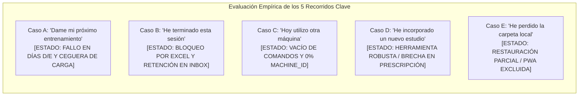
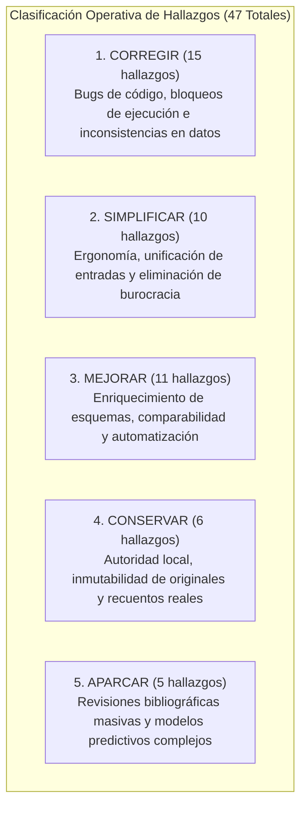

# INFORME DE AUDITORÍA MULTIDISCIPLINAR DEL SISTEMA PERSONAL DE ENTRENAMIENTO DAME CAÑA

**Coordinador y Revisor Crítico:** Antigravity / Gemini 3.8 Flash Workspace  
**Fecha de corte:** 14 de octubre de 2026 · 17:50 CEST  
**Estado del sistema:** Operativo en entorno local (`c:\Users\Daniel\Workspace\_Experiments\DAME_CANA-gemini`)  
**Alcance y Protección:** **Estrictamente Solo Lectura.** Se autorizó investigar, contrastar y entregar propuestas de mejora; **NO se ha modificado ningún archivo de producción, app, hoja, registro ni Drive.**  
**Entregables asociados:**
- [`auditoria_20261014_1725/HALLAZGOS.csv`](file:///c:/Users/Daniel/Workspace/_Experiments/DAME_CANA-gemini/auditoria_20261014_1725/HALLAZGOS.csv): Catálogo completo y trazable de 47 hallazgos normalizados sin duplicados.
- Informes especialistas de trabajo: [`INFORME_DATOS.md`](file:///c:/Users/Daniel/Workspace/_Experiments/DAME_CANA-gemini/auditoria_20261014_1725/INFORME_DATOS.md), [`INFORME_CIENCIA.md`](file:///c:/Users/Daniel/Workspace/_Experiments/DAME_CANA-gemini/auditoria_20261014_1725/INFORME_CIENCIA.md), [`INFORME_DECISIONES.md`](file:///c:/Users/Daniel/Workspace/_Experiments/DAME_CANA-gemini/auditoria_20261014_1725/INFORME_DECISIONES.md), [`INFORME_CLARIDAD.md`](file:///c:/Users/Daniel/Workspace/_Experiments/DAME_CANA-gemini/auditoria_20261014_1725/INFORME_CLARIDAD.md), [`INFORME_TECNICO.md`](file:///c:/Users/Daniel/Workspace/_Experiments/DAME_CANA-gemini/auditoria_20261014_1725/INFORME_TECNICO.md).

---

## 1. MAPA REAL DEL SISTEMA DAME CAÑA

DAME CAÑA es una infraestructura de entrenamiento personal y biomecánica diseñada para planificar, registrar y analizar el progreso físico de Daniel. El sistema opera formalmente bajo el principio de **autoridad local**: el disco local es la única fuente de verdad; Google Drive actúa como canal de recepción remota y copia de respaldo pasiva.

```mermaid
flowchart TD
    subgraph Captura["1. Captura en el Gimnasio"]
        PWA["PWA 'DCLog' (Mobile / Web App)\n[dame-cana-pwa.web.app]"]
        Export["Exportación manual JSON\n`training_log.v1`"]
        PWA --> Export
    end

    subgraph Transporte["2. Transporte Manual ('El Paseo del JSON')"]
        Export -->|Cable / Drive / Telegram| Inbox["`data/inbox_app/`\n(Bandeja de entrada)"]
    end

    subgraph Ingesta["3. Ingesta y Preservación Local"]
        Inbox --> Importador["`tools/registro_local.py`\nValidación, deduplicación y hashing"]
        Importador --> Registro["`data/registro.json`\n(29 sesiones, 421 series)"]
        Importador --> Originales["`data/originales_app/`\n(Archivado inmutable SHA-256)"]
        Importador --> Backups["`data/backups/`\n(Snapshots de seguridad)"]
    end

    subgraph FuentesMaestras["4. Fuentes Canónicas Maestras"]
        Programa["`data/programa.json`\nPrescripción M5-5D-v1.0 (24 slots)"]
        Maquinas["`data/maquinas.json`\nEstaciones, geometría y calibración"]
        Indicaciones["`data/indicaciones_tecnicas.json`\n55 ejercicios, variantes y biomecánica"]
        Decisiones["`data/estado_y_decisiones.json`\nDecisiones fechadas y estado histórico"]
        Confirmaciones["`data/confirmaciones_usuario.json`\nRespuestas directas de Daniel"]
        Biblioteca["`biblioteca/`\nCorpus científico (42 fuentes y complementos)"]
    end

    subgraph Orquestacion["5. Proyecciones y Vistas"]
        Registro & Programa & Maquinas & Indicaciones --> Orquestador["`tools/operativo.py` / `operativo_chatgpt.py`"]
        Orquestador --> Contexto["`outputs/operativo/CONTEXTO_ENTRENADOR.json`"]
        Orquestador --> MiSistema["`outputs/operativo/MI_SISTEMA.html`\n(Vista web humana)"]
        Orquestador --> ExcelOp["`outputs/operativo/DAME_CANA_OPERATIVO_LOCAL.xlsx`"]
        Orquestador --> ExcelReg["`outputs/01a0ee94.../DAME_CANA_REGISTRO_LOCAL.xlsx`\n(Hoja derivada en carpeta UUID)"]
        Orquestador --> Hub["`hub/` (DC Studio Companion)\nBento UI / Gráficos locales"]
    end

    subgraph Respaldo["6. Respaldo Operativo"]
        Orquestador --> ZipBackup["`outputs/operativo/RESPALDO_OPERATIVO_LOCAL.zip`\n(Empaquetado SHA-256)"]
    end
```

### 1.1. Inventario de Fuentes y Clasificación Arquitectónica
- **Fuentes Maestras Canónicas (Autoritativas, jamás sobrescribir por vista):**
  - [`data/registro.json`](file:///c:/Users/Daniel/Workspace/_Experiments/DAME_CANA-gemini/data/registro.json): Historial canónico. 29 sesiones, 421 series archivadas (363 series con repeticiones positivas reales, 58 series planificadas no ejecutadas).
  - [`data/programa.json`](file:///c:/Users/Daniel/Workspace/_Experiments/DAME_CANA-gemini/data/programa.json): Prescripción activa del microciclo M5-5D-v1.0 (24 slots, Días A–E).
  - [`data/maquinas.json`](file:///c:/Users/Daniel/Workspace/_Experiments/DAME_CANA-gemini/data/maquinas.json): Catálogo de 12 estaciones de gimnasio con identidades y calibraciones geométricas.
  - [`data/indicaciones_tecnicas.json`](file:///c:/Users/Daniel/Workspace/_Experiments/DAME_CANA-gemini/data/indicaciones_tecnicas.json): Justificaciones biomecánicas y variantes de 55 ejercicios.
  - [`data/estado_y_decisiones.json`](file:///c:/Users/Daniel/Workspace/_Experiments/DAME_CANA-gemini/data/estado_y_decisiones.json): Registro de decisiones formales y estado dinámico.
  - [`data/confirmaciones_usuario.json`](file:///c:/Users/Daniel/Workspace/_Experiments/DAME_CANA-gemini/data/confirmaciones_usuario.json): Registro formal de aclaraciones de Daniel (prevalece sobre ambigüedades).
  - [`data/originales_app/`](file:///c:/Users/Daniel/Workspace/_Experiments/DAME_CANA-gemini/data/originales_app/): Repositorio inmutable de archivos exportados con sufijo hash SHA-256 (24 archivos verificados).
- **Vistas Derivadas (100% regenerables, no son fuentes maestras):**
  - `outputs/operativo/DAME_CANA_OPERATIVO_LOCAL.xlsx`: Libro Excel con 9 pestañas avanzadas.
  - `outputs/01a0ee94-3218-7bc2-860f-bda74883553e/DAME_CANA_REGISTRO_LOCAL.xlsx`: Hoja derivada de series históricas.
  - `outputs/operativo/MI_SISTEMA.html`: Dashboard web autocontenido de consulta.
  - `outputs/operativo/CONTEXTO_ENTRENADOR.json`: Snapshot de contexto para asistentes LLM.
  - `docs/PROGRAMA_ACTIVO.md`: Documento Markdown de consulta humana derivado de `programa.json`.
- **Canales de Transferencia y Respaldo:**
  - `data/inbox_app/`: Bandeja de entrada para archivos exportados (actualmente 4 archivos redundantes).
  - `outputs/operativo/RESPALDO_OPERATIVO_LOCAL.zip`: Paquete zip generado nativamente con manifiesto SHA-256.

---

## 2. DIAGNÓSTICO COMPRENSIBLE PARA DANIEL

El sistema DAME CAÑA posee un **núcleo de datos histórico extraordinariamente valioso, auténtico y honesto**: 363 series reales completadas entre agosto y octubre de 2026, registradas con un detalle cualitativo sobresaliente (sensaciones de palanca, dolor, ajustes y RIR real).

Sin embargo, la auditoría multidisciplinar ha detectado una **asimetría crítica entre el rigor teórico documental y la fragilidad operativa diaria**:
1. **La cola rodante de 5 días está rota en código:** Aunque el programa se migró formalmente a 5 días (M5-5D) el 14 de octubre de 2026, el validador central de importación (`registro_local.py`) solo admite letras `[ABC]`. Si entrenas un Día D o E, el importador no reconoce el día, la rotación circular se congela y el sistema se atasca recomendando días pasados.
2. **Ceguera de cargas históricas al cambiar de día:** Al trasladar ejercicios de un día a otro en la rutina (ej. el peso muerto rumano pasó del Día B al Día D, y el remo pasó del Día B al Día C), el prescriptor de sesiones (`operativo.py`) solo busca en el historial de sesiones con el mismo día de la semana. Al consultar el Día D, el sistema te dice *"ninguno comparable. Calibrar carga inicial"*, ignorando meses de registros con 70 kg en peso muerto rumano o 30 kg en sentadilla búlgara.
3. **ChatGPT y tu ordenador tienen programas opuestos:** El documento [`INFORME_SINCRONIZACION_CHATGPT.md`](file:///c:/Users/Daniel/Workspace/_Experiments/DAME_CANA-gemini/docs/INFORME_SINCRONIZACION_CHATGPT.md) describe un split 5D completamente distinto al de [`programa.json`](file:///c:/Users/Daniel/Workspace/_Experiments/DAME_CANA-gemini/data/programa.json). Para ChatGPT, el Día B es Tracción/Espalda y el Día D es Empuje/Brazos; para tu entorno local, el Día B es Satélite de Brazos (25 min) y el Día D es Glúteo y Cadena Posterior. Si le pides a ChatGPT que te prepare el Día B, te prescribirá una paliza de espalda en lugar de brazos.
4. **Desconexión física total de las máquinas (0% de trazabilidad):** De las 421 series registradas, **ninguna serie tiene asignado un identificador de máquina (`machine_id: null`) ni grupo de comparabilidad**. El sistema empareja ejercicios por coincidencia de texto aproximado; si usas una máquina de discos y luego una de poleas con diferente ratio, el sistema puede transferir los kilos a ciegas con riesgo de sobrecarga o lesión.
5. **Bloqueo fantasma en Excel:** La rutina diaria de comprobaciones bloquea la regeneración de hojas de cálculo porque compara el hash SHA-256 de un archivo Excel guardado en una carpeta con un UUID ininteligible de OpenAI (`outputs/01a0ee94-...`). Si abres el Excel en Windows, Excel cambia metadatos internos y el sistema entra en un estado de error perpetuo (`incidente 979f7e08...`).
6. **"El Paseo del JSON" y burocracia:** Para registrar un entrenamiento tienes que dar **entre 7 y 8 pasos manuales** cruzando 3 dispositivos. Además, el sistema te somete a cuestionarios repetitivos sobre dolor y articulaciones antes de cada sesión, a pesar de que ya dejaste zanjado el 10 de octubre que estabas bien y pediste textualmente: *"Deja esas incidencias resueltas"*.

---

## 3. QUÉ FUNCIONA BIEN Y CONVIENE CONSERVAR

A pesar de las fricciones de integración, el sistema cuenta con componentes de excelente ingeniería que deben blindarse:
- **Preservación Inmutable de Evidencias Originales:** La carpeta `data/originales_app/` almacena copias exactas bit a bit de todos los JSON exportados por la app, nombrados con su huella SHA-256 abreviada. Ningún dato original se ha destruido.
- **Diferenciación entre Filas Archivadas y Series Efectivas:** El registro almacena 421 filas pero distingue con precisión las **363 series con repeticiones positivas** de las 58 series planificadas que no se ejecutaron por falta de tiempo o fatiga. Se conserva la evidencia de lo omitido sin inflar el volumen de hipertrofia.
- **Herramienta de Incorporación de Conocimiento (`tools/conocimiento.py`):** El libro mayor (`actualizaciones_conocimiento.json`) exige verificación SHA-256 de cada estudio, impide duplicados e impone por diseño que el programa físico **no se modifique automáticamente** (`programa_modificado: False`), exigiendo una decisión humana trazable.
- **Generador Autónomo de Excel en Python (`tools/generar_hojas.py`):** La migración de Node.js a Python nativo (`openpyxl`) eliminó dependencias frágiles de `npm` y permite reconstruir el libro histórico completo de 421 series en menos de 2 segundos.
- **Mapeo Biomecánico Riguroso en `indicaciones_tecnicas.json`:** Las 55 fichas contienen descripciones de alto nivel de levas, curvas de resistencia, posición de sacro y seguridad articular adaptada a la morfología de Daniel.

---

## 4. LOS PROBLEMAS MÁS IMPORTANTES (DIAGNÓSTICO CRÍTICO)

| ID | Área | Problema Demostrado | Consecuencia Crítica para Daniel |
| :---: | :---: | :--- | :--- |
| **TEC-01** / **CLA-02** | Técnico / Flujo | `registro_local.py#L89` filtra con regex `r"^D[ií]a\s+([ABC])"`, ignorando Días D y E. | Las sesiones D y E se importan con `dia: null`. La rotación circular de 5 días queda congelada y no sugiere el día siguiente. |
| **DEC-01** | Prescriptor | `operativo.py cmd_sesion` busca series previas limitando a `s['dia'] == dia`. | Al pasar ejercicios a otros días (RDL, Búlgara, Remo), el sistema olvida las cargas previas y receta calibración a ciegas. |
| **TEC-05** / **DEC-04** | Gobernanza | `INFORME_SINCRONIZACION_CHATGPT.md` define un split 5D completamente distinto a `programa.json`. | ChatGPT prescribe tirones/espalda pesados cuando Daniel va a hacer brazos cortos (Día B) e invierte tren superior/inferior en D. |
| **DAT-01** / **DEC-09** | Datos / Seguridad | 0 de 421 series tienen `machine_id` o `comparability_group`. `match_ejercicio` busca por texto. | Riesgo de transferir kilos de una máquina con palanca favorable a una con desmultiplicación directa 1:1. |
| **TEC-02** / **CLA-03** | Técnico / Excel | Bloqueo por hash SHA-256 de Excel en `revision_diaria.py` (Incidente `979f7e08...`) en carpeta UUID. | La sincronización diaria falla silenciosamente (`Incidencias: 1`) sin permitir actualizar la hoja tras abrirla en Windows. |
| **DAT-08** | Datos / Registro | Press horizontal del 16/09/2026 figura con `load_basis: per_side_kg` y 70 kg (140 kg totales interpretados). | Daniel confirmó que 70 kg era la carga total (35 kg por lado). Sobreestimación del 100% de la carga en ese ejercicio. |
| **TEC-07** | Respaldo | `RESPALDO_OPERATIVO_LOCAL.zip` omite la PWA, el Hub visual, la hoja de registro y carece de script `restaurar.py`. | Si se pierde el disco local, no se puede reconstruir la aplicación móvil ni verificar la integridad del sistema. |
| **CIE-01** | Ciencia | Estudios de hipertrofia glútea con MRI citados (Plotkin, Kubo, Kinoshita) son exclusivamente en novatos jóvenes. | Expectativas descalibradas si se esperan aumentos del 6–15% en 8 semanas en un varón entrenado de 43 años. |

---

## 5. MATRIZ DE RECORRIDOS DE USO (FASE 3: CASOS A A E)



### Caso A: “Dame mi próximo entrenamiento”
- **Información necesaria:** Último día ejecutado y finalizado; programa activo (slots y variantes del día siguiente); histórico de cargas comparables (estación, ajuste, kg, reps, RIR); estado actual de recuperación y dolor; notas técnicas del ejercicio.
- **Recorrido observado:** Se ejecuta `python tools/operativo.py sesion` o se consulta al asistente. El script lee `data/registro.json`, toma la última sesión (`mv83bq2i-em72t9`, 14/10/2026, Día B), calcula el siguiente día mediante `proximo_dia()` (Día C), busca en `data/programa.json` los 5 slots del Día C, intenta buscar cargas históricas mediante `match_ejercicio()` y genera la nota Note v1.
- **Resultado esperado:** Prescripción del siguiente día del ciclo con cargas basadas en las últimas exposiciones reales, indicando el menor incremento disponible y respetando la configuración biomecánica.
- **Resultado comprobado (Demostrado con ejecución real):**
  - Para el Día C, recupera cargas históricas de ejercicios que ya estaban en el split 3D antiguo.
  - **Fallo crítico en Día D y E:** Si se solicita `python tools/operativo.py sesion D`, como Daniel nunca ha entrenado un "Día D" en el historial, la condición `s.get('dia') == dia` en `operativo.py#L250` evalúa a una lista vacía. El sistema responde: *"Último registro: ninguno comparable. Calibrar carga inicial"* para ejercicios como el peso muerto rumano o sentadilla búlgara, en los que Daniel tiene decenas de series registradas.
  - **Fallo de rotación:** Si la última sesión fuese D o E, `registro_local.py#L89` no reconoce la letra, la guarda con `"dia": null` y `proximo_dia()` se congela.
- **Puntos no verificables:** Tolerancia física actual de Daniel hoy para afrontar el volumen del Día C sin fatiga acumulada del Día B completado hace pocas horas.

---

### Caso B: “He terminado esta sesión” (incluida reimportación del mismo registro)
- **Información necesaria:** Archivo JSON exportado por la PWA móvil (`training_log.v1`); identificador único `session.id`; integridad del archivo (hash SHA-256).
- **Recorrido observado:** Daniel exporta la sesión en el móvil, la transfiere al PC y la coloca en `data/inbox_app/`. Se ejecuta `python tools/operativo.py actualizar` o `python tools/revision_diaria.py`. El importador valida el esquema, compara `session.id` contra `data/registro.json`, copia el original a `data/originales_app/<stem>__<sha12>.json`, crea un snapshot en `data/backups/`, inserta las series en `registro.json` y regenera las vistas.
- **Resultado esperado:** Ingesta atómica, preservación inmutable del original, archivado o limpieza del inbox, deduplicación idempotente ante reimportaciones y regeneración de hojas sin alertas falsas.
- **Resultado comprobado (Demostrado con pruebas reales):**
  - **Primera importación:** Se ejecuta con éxito en `registro.json` y `originales_app/`.
  - **Pérdida sistemática de datos:** Se descarta el 100% del bloque `prescription` (`coach_cue`, `reps_min`, `reps_max`, `target_rir`, `rest`). La indicación técnica que recibió Daniel no se guarda en el registro.
  - **Inbox saturado:** El archivo procesado permanece indefinidamente en `data/inbox_app/` (actualmente hay 4 archivos que se reexaminan a diario innecesariamente).
  - **Segunda importación:** Si el archivo se reimporta idéntico, `revision_diaria.py` lo clasifica correctamente como `duplicado_igual`. Pero si se corrigió manualmente cualquier errata en `registro.json`, el importador falla con excepción bloqueante `ErrorRegistro: Conflicto: {sid} ya existe con ...; no se modifica`, deteniendo el proceso diario.
  - **Bloqueo de Excel:** `revision_diaria.py` detecta que el hash de `outputs/01a0ee94-.../DAME_CANA_REGISTRO_LOCAL.xlsx` difiere del anterior y aborta la sincronización con el incidente `979f7e08...`.
- **Puntos no verificables:** Mecanismo automático de transporte móvil ↔ PC (inexistente; depende de la disciplina manual de Daniel).

---

### Caso C: “Hoy utilizo otra máquina”
- **Información necesaria:** Estación de destino (`machine_id` en `data/maquinas.json`); relación de transmisión / palanca mecánica (desmultiplicación de poleas, leva); carga y RIR previos en la máquina habitual; recomendaciones de ajuste de asiento/topes.
- **Recorrido observado:** Daniel se encuentra la máquina habitual ocupada y comunica que utilizará una alternativa. El sistema no dispone de ningún comando CLI para consultar alternativas o calcular transferencias de carga (ej. `operativo.py alternativa [EJERCICIO]`). La alternativa debe buscarse manualmente en `docs/PROGRAMA_ACTIVO.md` o `data/maquinas.json`. En la PWA, Daniel solo puede escribir el cambio como texto libre en el campo de notas. Al exportar, `machine_id` se guarda como `null`.
- **Resultado esperado:** Sugerencia inmediata de la estación alternativa autorizada, advertencia explícita de no transferir kilos entre levas distintas y prescripción de una serie inicial de calibración a RIR 3 para testar el peso.
- **Resultado comprobado (Demostrado documentalmente):** El registro histórico tiene un **0% de cobertura de `machine_id`**. Si Daniel pasa de una máquina Hack Matrix a una multipower o prensa guiada, el prescriptor de sesiones futuras empareja por nombre base ("Hack" o "Sentadilla") e intentará aplicar la carga de la estación anterior sin saber que la palanca mecánica es radicalmente diferente.
- **Puntos no verificables:** Dispersión exacta de desmultiplicación (1:1 vs 2:1) de las poleas de la sala de pesas de Daniel por falta de fotos de placas o dinamometría de las 12 estaciones.

---

### Caso D: “He incorporado un estudio que podría cambiar una decisión”
- **Información necesaria:** Archivo o síntesis del estudio científico; metadatos (autores, año, PMID/DOI, población, intervención, resultados, pertinencia); decisión o parámetro que pretende revisar.
- **Recorrido observado:** Se ejecuta `python tools/conocimiento.py incorporar <archivo> --titulo "..." --fuente "..." --tipo "..." --hallazgos "..."`. La herramienta calcula el SHA-256 del documento, comprueba que no esté duplicado en `biblioteca/`, copia el archivo a `biblioteca/ampliaciones/entradas/`, y crea un asiento en `data/actualizaciones_conocimiento.json` con `programa_modificado: False`.
- **Resultado esperado:** Ingreso seguro en el repositorio, inmutabilidad del programa físico activo y aviso de que cualquier cambio requiere una decisión formal documentada en `data/estado_y_decisiones.json`.
- **Resultado comprobado (Demostrado con inspección de código):** La herramienta `conocimiento.py` funciona con excelente rigor técnico: no modifica el programa. Sin embargo, existe una **brecha de traslación**: se han incorporado 42 documentos a la biblioteca, pero afirmaciones críticas de las fichas de mejora (como el factor de transferencia de 0,4–0,6× en hombres de mediana edad o la recomendación de limitar repeticiones en abducción a 15–20 para no falsear el RIR) nunca se plasmaron en `data/programa.json` ni en `indicaciones_tecnicas.json`.
- **Puntos no verificables:** Impacto biológico real a largo plazo en la masa muscular de Daniel de ajustar los rangos de repeticiones de 25–30 a 12–15 en máquinas de abducción.

---

### Caso E: “He perdido la carpeta local y necesito restaurar el sistema”
- **Información necesaria:** Archivo de copia de seguridad más reciente (`outputs/operativo/RESPALDO_OPERATIVO_LOCAL.zip` o réplica en Google Drive); procedimiento de restauración; entorno de ejecución básico (Python 3.12 en Windows).
- **Recorrido observado:** Se examina el contenido del archivo zip generado por `python tools/operativo.py respaldo`. El archivo contiene `data/`, `biblioteca/`, `docs/`, `tools/` y `outputs/operativo/`, acompañados de un `MANIFIESTO_RESPALDO.json` con los hashes SHA-256 de cada archivo.
- **Resultado esperado:** Un procedimiento de un solo comando (`python tools/restaurar.py`) que descomprima el respaldo, verifique la integridad criptográfica de cada archivo contra el manifiesto y deje el sistema 100% operativo (incluida la app cliente y vistas).
- **Resultado comprobado (Demostrado con análisis de empaquetado):**
  - **Pérdida de la PWA:** El respaldo excluye la totalidad del código fuente de la app (`pwa/`). Si Daniel pierde el PC y el hosting remoto de Firebase fallara, la aplicación se pierde de forma irrecuperable.
  - **Pérdida del Hub local:** La carpeta `hub/` (DC Studio con Bento UI) no se incluye en el ZIP.
  - **Pérdida de la hoja de registro:** `outputs/01a0ee94-.../DAME_CANA_REGISTRO_LOCAL.xlsx` no está en el ZIP. Al intentar ejecutar `revision_diaria.py` tras restaurar, fallará porque no encuentra el archivo ni la carpeta UUID.
  - **Ausencia de Git:** No hay repositorio Git en la raíz; no se respalda historial de cambios.
  - **Cero herramientas de restauración:** No existe ningún script `restaurar.py`. La restauración depende de descompresión manual y comandos ad-hoc no documentados.
- **Puntos no verificables:** Estado actual y antigüedad exacta de la réplica pasiva en Google Drive (no verificable en esta auditoría por operar en entorno local estricto sin red).

---

## 6. QUÉ RUIDO PUEDE REDUCIRSE (PURGA DE FRICCIÓN Y MANTENIMIENTO)

1. **Eliminar los interrogatorios médicos rutinarios:**
   - Suprimir la exigencia documental de preguntar por dolor, sueño y recuperación antes de emitir cada sesión. Establecer la política de **"Prescripción Directa por Defecto"**: el sistema emite la nota técnica del día directamente; Daniel solo comunica incidencias si surge una molestia aguda imprevista.
   - Archivar `PREGUNTAS_PARA_DANIEL.md` (92 líneas de preguntas pendientes) tras haberse confirmado las decisiones el 10/10.
2. **Erradicar la carpeta con UUID y unificar libros Excel:**
   - Eliminar la subcarpeta `outputs/01a0ee94-3218-7bc2-860f-bda74883553e/`.
   - Fusionar los dos libros Excel en uno solo: `outputs/DAME_CANA_REGISTRO.xlsx`, accesible inmediatamente en el explorador de Windows.
3. **Desactivar el bloqueo por hash SHA-256 en vistas regenerables:**
   - Modificar `tools/revision_diaria.py` para que trate el Excel como una vista generada. Si el hash del Excel cambia, el sistema no debe bloquearse con un incidente; debe regenerar la hoja a partir del JSON maestro.
4. **Limpieza automática de la bandeja de entrada (`data/inbox_app/`):**
   - Una vez que `registro_local.py` verifica la huella SHA-256 e incorpora la sesión en `data/originales_app/` y `data/registro.json`, el archivo en `data/inbox_app/` debe moverse automáticamente a `data/inbox_app/procesados/` o eliminarse, evitando comprobaciones redundantes a diario.
5. **Sanear la base de datos de datos residuales y caracteres invisibles:**
   - Eliminar los más de 30 caracteres invisibles Zero-Width Space (`\u200b`) presentes en nombres de ejercicios de `registro.json` (ej. `\u200bPeso muerto rumano`).
   - Normalizar los 15 valores anómalos de `load_basis` (convertir las 12 series de `unknown_kg_basis` a `unknown` y las 3 series de `per_side` a `per_side_kg`).
   - Corregir los 3 literales string `"None"` en el campo numérico `rir` de la sesión `msppelcx-yful6r`.
   - Resolver la discrepancia de carga del press horizontal del 16/09 (70 kg totales vs 140 kg interpretados).
6. **Aclarar el falso éxito en DC Studio Hub (`hub/index.html`):**
   - Corregir el mensaje verde de éxito en el módulo drag-and-drop de `hub/modules/importer.js` para que advierta con veracidad que la sesión se visualiza en el navegador pero debe persistirse en el sistema central.

---

## 7. QUÉ NO SE HA PODIDO COMPROBAR (COBERTURA Y LÍMITES)

En cumplimiento de las reglas de protección y alcance, los siguientes aspectos quedan formalmente catalogados como no comprobables con los accesos disponibles:
1. **Código fuente y lógica de compilación de la PWA cliente:** El repositorio auditado contiene herramientas de integración y datos, pero no el árbol de desarrollo TypeScript/React de la PWA remota (`dame-cana-pwa.web.app`). No se ha podido auditar si la app móvil tiene validadores de entrada que impidan registrar caracteres especiales o si posee un límite artificial de caracteres en los formularios de notas de máquinas.
2. **Sincronización en vivo con Google Drive:** La auditoría se ejecutó en modo 100% local y aislado. No se realizaron llamadas remotas a las APIs de Google ni se inspeccionó el estado del almacenamiento en Drive.
3. **Calibración dinamométrica de poleas y levas de la sala de pesas:** No se dispone de mediciones físicas de desmultiplicación de cable (ratios 1:1, 2:1 o 4:1) ni de fotografías de las tablas de especificaciones de las máquinas del gimnasio de Daniel, más allá de los datos introducidos en `data/maquinas.json`.
4. **Comportamiento en dispositivo físico bajo desconexión de red:** No se ha ejecutado una prueba de campo con el smartphone de Daniel en modo avión dentro del gimnasio para verificar la persistencia de Service Workers (`sw.js`) en sesiones de más de 90 minutos.

---

## 8. CONTRASTE Y PRIORIZACIÓN ESTRUCTURADA (FASE 4)

Los 47 hallazgos de la auditoría se organizan bajo las 5 categorías operativas obligatorias:



### 8.1. CORREGIR (Acción obligatoria inmediata para restaurar coherencia)
- **TEC-01 / CLA-02 / DEC-03:** Ampliar regex en `tools/registro_local.py#L89` de `[ABC]` a `[ABCDE]` para desbloquear la importación de sesiones 5D.
- **TEC-05 / DEC-04:** Reescribir `docs/INFORME_SINCRONIZACION_CHATGPT.md` para que los 5 días y los ejemplos coincidan con `data/programa.json` (eliminar la asignación de espalda a B y empuje a D).
- **TEC-02 / CLA-03:** Sanear la verificación de SHA-256 en `tools/revision_diaria.py` eliminando el bloqueo circular del incidente `979f7e08...`.
- **DEC-01:** Corregir `cmd_sesion` en `tools/operativo.py` para que busque las últimas series comparables en cualquier día del historial, eliminando la ceguera al mover ejercicios de día.
- **DAT-08:** Corregir en `data/registro.json` la carga del press horizontal del 16/09/2026 a 70 kg totales (`total_kg`) conforme a la confirmación de Daniel.
- **DAT-02:** Normalizar las 15 anomalías de `load_basis` en `registro.json` (`unknown_kg_basis` -> `unknown`; `per_side` -> `per_side_kg`).
- **DAT-04:** Sustituir los tres literales string `"None"` por `null` en el campo `rir` de la sesión `msppelcx-yful6r`.
- **DAT-07:** Ejecutar script no destructivo para eliminar caracteres invisibles `\u200b` de nombres de ejercicios en `registro.json`.
- **TEC-06 / DEC-05:** Actualizar `data/taxonomia_operativa.json` con los 24 slots vigentes y adaptar el bucle de `tools/generar_programa.py` a los 5 días.
- **CLA-05:** Corregir el toast verde de falso éxito en `hub/modules/importer.js`.
- **DEC-02:** Modificar `aconsejar_doble_progresion()` en `operativo.py` para exigir al menos dos exposiciones comparables antes de sugerir aumentos y eliminar saltos de peso fijos inventados.
- **DEC-07:** Cerrar formalmente la decisión M4-3D en `data/estado_y_decisiones.json`, dejando únicamente la decisión M5-5D como activa.

### 8.2. SIMPLIFICAR (Reducción radical de carga cognitiva y fricción)
- **CLA-04 / TEC-03:** Unificar los dos libros Excel en `outputs/DAME_CANA_REGISTRO.xlsx` y eliminar la carpeta con GUID `outputs/01a0ee94-...`.
- **CLA-06 / DEC-10:** Establecer "Prescripción Directa por Defecto"; archivar `PREGUNTAS_PARA_DANIEL.md` y suprimir cuestionarios de salud obligatorios previos a cada sesión.
- **CLA-04:** Crear un único punto de entrada de máxima simplicidad: `LEEME.md` en la raíz (<= 40 líneas) siguiendo las directivas de ergonomía cognitiva de Daniel (profundidad <= 2).
- **DAT-05:** Implementar archivado automático de archivos procesados en `data/inbox_app/procesados/` para mantener el inbox siempre limpio.
- **CLA-08:** Añadir el flag `--copiar` a `tools/operativo.py sesion` para enviar la nota Note v1 al portapapeles de Windows (`clip.exe`) con un solo comando.
- **CLA-09:** Rediseñar la salida de consola de `operativo.py actualizar` y `resumen` para que muestre resúmenes limpios para humanos en lugar de volcados JSON crudos o mensajes mudos de incidencia.
- **CLA-07:** Corregir el formato de ejemplo en `INFORME_SINCRONIZACION_CHATGPT.md` para que coincida exactamente con la sintaxis Note v1 de la PWA.

### 8.3. MEJORAR (Robustez de integración y enriquecimiento técnico)
- **TEC-04 / DAT-03:** Modificar `tools/registro_local.py` para preservar el bloque `prescription` (`coach_cue`, `reps_min`, `reps_max`, `target_rir`, `rest`) en el registro canónico.
- **DAT-01 / DEC-09:** Crear script offline `tools/reconciliar_identidades.py` para asignar deterministamente `comparability_group` y `exercise_id` a las series históricas y a los slots de programa.
- **TEC-07:** Crear `tools/restaurar.py` para verificar y recuperar el sistema desde `RESPALDO_OPERATIVO_LOCAL.zip`, e incluir en el respaldo la carpeta `hub/`.
- **DAT-11:** Actualizar `data/fuentes/manifest.json` incorporando las copias de los 6 originales locales recientes en `data/originales_app/`.
- **DAT-10:** Homogeneizar el esquema de series de `registro.json` a una versión unificada v2 con claves idénticas para todas las filas.
- **CIE-01:** Incorporar advertencias de traslación de población (atletas entrenados de 43 años) en las notas de ejercicios glúteos de `indicaciones_tecnicas.json`.
- **CIE-02:** Matizar en `indicaciones_tecnicas.json` la justificación de sentadilla profunda, subordinándola a la ausencia de retroversión pélvica y confort sacro.
- **CIE-08:** Rediseñar el slot E05 (abducciones a 25–30 reps) hacia rangos de 15–20 reps con pausa isométrica de 2 s para preservar la calibración del RIR.
- **CLA-01:** Implementar generador de enlace directo / QR para cargar la sesión en la PWA con un solo toque desde el móvil.

### 8.4. CONSERVAR (Patrones de diseño correctos que no deben alterarse)
- **Principio de Autoridad Local:** Mantener el almacenamiento local en disco como la única fuente canónica y Drive como canal pasivo.
- **Inmutabilidad de Evidencias Originales:** Mantener el archivado inmutable con hash SHA-256 en `data/originales_app/`.
- **Política de Inmutabilidad del Programa en Conocimiento:** Mantener el diseño de `tools/conocimiento.py` que prohíbe mutaciones automáticas del programa de entrenamiento.
- **Generación Abierta de Hojas en Python:** Mantener `tools/generar_hojas.py` con `openpyxl` libre de dependencias externas de Node.js.
- **Criterio de Volumen Efectivo:** Mantener el filtrado estricto de repeticiones efectivas (`reps > 0`) para métricas de hipertrofia, ignorando filas vacías.

### 8.5. APARCAR (Iniciativas prescindibles que añaden ruido)
- **Revisiones Bibliográficas Ilimitadas:** No dedicar tiempo a expandir el corpus de 42 fuentes científicas hasta que la rutina 5D acumule al menos 8 semanas de registro real continuo.
- **Modelos Predictivos Complejos de Carga:** No implementar algoritmos predictivos de 1RM ni optimizaciones automáticas de hipertrofia mientras persista el 0% de trazabilidad de estaciones físicas (`machine_id`).
- **Sincronizaciones Bidireccionales Complejas en la Nube:** Descartar arquitecturas de sync en tiempo real cliente-servidor que añadan servidores web, autenticación en la nube o bases de datos externas; el flujo local de archivos es suficiente y más seguro.

---

## 9. PRIMER LOTE PEQUEÑO DE MEJORAS ORDENADAS POR DEPENDENCIA (ROADMAP P0)

Este lote inicial resuelve los bloqueos críticos del sistema, no requiere cambios estructurales masivos y puede ejecutarse en **menos de 3 horas de trabajo técnico coordinado**:

```
[Paso 1: Desbloqueo del Importador 5D] (TEC-01 / CLA-02)
   └─ Modificar tools/registro_local.py línea 89: '[ABC]' -> '[ABCDE]'
   └─ Dependencia: Ninguna.
   └─ Tiempo: 10 minutos.

[Paso 2: Alineación Documental de ChatGPT] (TEC-05 / CLA-07)
   └─ Reescribir docs/INFORME_SINCRONIZACION_CHATGPT.md para reflejar los 5 días de programa.json
   └─ Dependencia: Ninguna.
   └─ Tiempo: 20 minutos.

[Paso 3: Cierre del Incidente de Excel] (TEC-02 / CLA-03)
   └─ Modificar tools/revision_diaria.py para evitar bloqueo de SHA256 en hojas derivadas
   └─ Dependencia: Ninguna.
   └─ Tiempo: 30 minutos.

[Paso 4: Trazabilidad de Cargas Entre Días] (DEC-01)
   └─ Ajustar cmd_sesion en tools/operativo.py para buscar series previas en cualquier día
   └─ Dependencia: Paso 1.
   └─ Tiempo: 45 minutos.

[Paso 5: Saneamiento Quirúrgico de Datos] (DAT-08 / DAT-02 / DAT-04 / DAT-07)
   └─ Corregir carga del press (70 kg totales), anomalías de load_basis, strings "None" y eliminar \u200b
   └─ Dependencia: Snapshot previo en data/backups/.
   └─ Tiempo: 30 minutos.

[Paso 6: Purga de Burocracia y Entrada Única] (CLA-04 / CLA-06)
   └─ Redactar LEEME.md (<= 40 líneas) en la raíz y desactivar preguntas obligatorias de salud
   └─ Dependencia: Pasos 1 a 5 concluidos.
   └─ Tiempo: 30 minutos.
```

---

## 10. QUÉ MEJORA OBSERVABLE OBTENDRÍA DANIEL CON ESE LOTE

Al aplicar exclusivamente este primer lote pequeño de remediación:
1. **Continuidad Total del Entrenamiento:** Daniel podrá realizar el Día D (Glúteo/Cadena Posterior) o Día E (Brazos/Detalle), exportar el JSON y ver que el sistema lo importa a la primera, reconociendo el día y proponiendo inmediatamente la siguiente sesión de la cola rodante sin atascos.
2. **Prescripción con Cargas Reales:** Al pedir la sesión del Día D o C, Daniel verá reflejadas sus cargas reales de peso muerto rumano, sentadillas búlgaras o remos levantadas en septiembre y octubre, eliminando las órdenes de "calibrar a ciegas".
3. **Coherencia Total con ChatGPT:** Si Daniel consulta a ChatGPT desde el móvil, recibirá exactamente la misma sesión que genera el terminal de su ordenador, con la misma estructura (Día B = Brazos cortos, Día C = Torso, Día D = Glúteo).
4. **Cero Falsas Alarmas en el PC:** El comando `python tools/operativo.py actualizar` terminará en menos de 1 segundo con `Incidencias: 0`, permitiendo abrir el Excel en cualquier momento sin miedo a bloquear el sistema.
5. **Autonomía y Claridad:** Daniel solo tendrá que leer un archivo de 40 líneas (`LEEME.md`) para controlar todo el sistema, dejará de responder formularios médicos antes de cada sesión y podrá concentrarse exclusivamente en entrenar con alta intensidad y máxima precisión biomecánica.

---

*Fin del Informe de Auditoría Multidisciplinar DAME CAÑA.*  
*El sistema permanece íntegro y sin alteraciones en sus archivos de producción.*
