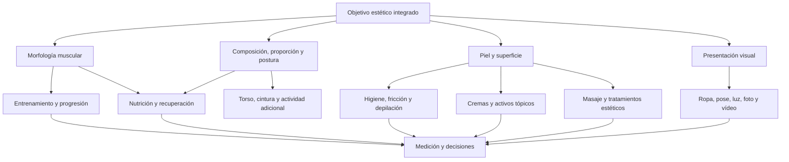

# Fase 1 — Mapa de campo

## Propósito

Delimitar qué debe investigar el proyecto, cómo se relacionan las áreas y qué resultados pertenecen al entrenamiento, a la composición corporal, a la piel o a la presentación.

## Mapa causal

## Dominios de investigación

| Código | Dominio | Resultado que debe explicar |
|---|---|---|
| D01 | Anatomía regional | Qué tejidos y regiones pueden modificar la forma |
| D02 | Biomecánica | Cómo posiciones, palancas y estabilidad cambian el estímulo |
| D03 | Hipertrofia | Qué dosis y condiciones favorecen crecimiento |
| D04 | Ejercicios | Qué movimientos cubren cada función con buena relación estímulo-fatiga |
| D05 | Programación | Cómo combinar, progresar, periodizar y descargar |
| D06 | Modalidades complementarias | Valor de potencia, sprint, pliometría, isometrías, bandas y microseries |
| D07 | Nutrición y composición | Cómo sostener recomposición o fases específicas |
| D08 | Recuperación y seguridad | Cómo gestionar fatiga, dolor, sueño y compatibilidad global |
| D09 | Estética masculina | Cómo el desarrollo regional altera proporciones y percepción |
| D10 | Piel y depilación | Cómo reducir irritación, foliculitis, textura y marcas |
| D11 | Cremas y cuidados | Qué activos tienen utilidad, riesgo y coste razonables |
| D12 | Masaje y técnicas manuales | Qué efectos son reales, transitorios o no demostrados |
| D13 | Tratamientos estéticos | Qué opciones profesionales de bajo coste ofrecen valor verificable |
| D14 | Presentación | Cómo ropa, pose, luz y cámara alteran la apariencia |
| D15 | Seguimiento | Cómo distinguir progreso de ruido de medición |
| D16 | Coste y sostenibilidad | Qué intervención aporta más beneficio por tiempo, dinero y complejidad |

## Resultados estéticos observables

| Resultado | Determinantes principales | Determinantes secundarios | No debe confundirse con |
|---|---|---|---|
| Proyección posterior | Masa y distribución del glúteo mayor | Pelvis, grasa, pose | Congestión de una sesión |
| Plenitud superior | Desarrollo regional y proporción cintura-cadera | Glúteo medio, grasa, luz | “Activación” aislada |
| Anchura visual | Estructura, masa lateral y composición | Ropa y postura | Ensanchar huesos mediante ejercicio |
| Elevación/firmeza | Masa, composición y presentación | Tono transitorio, pose | Lifting permanente por crema |
| Transición glúteo-femoral | Desarrollo relativo y grasa | Postura y luz | Reducción localizada garantizada |
| Superficie uniforme | Control de irritación, folículos y pigmentación | Depilación, fricción, hidratación | Crecimiento muscular |
| Simetría | Desarrollo, técnica y anatomía | Pose y colocación de cámara | Igualdad anatómica perfecta |

## Fronteras del proyecto

- El proyecto puede evaluar cuidados cosméticos y tratamientos no quirúrgicos; no diagnosticará enfermedades cutáneas.
- Las recomendaciones médicas, farmacológicas o invasivas requerirán derivación y fuentes clínicas apropiadas.
- No se investigarán sustancias no aprobadas como atajos seguros.
- Una intervención estética se puntuará por magnitud, duración, coste, riesgos, mantenimiento y calidad de evidencia.
- Los efectos inmediatos o transitorios se etiquetarán como tales.

## Producto de la fase 1

El campo queda dividido en dominios investigables, resultados observables y límites de interpretación. La fase 1 no pretende resolver todavía las preguntas científicas.

