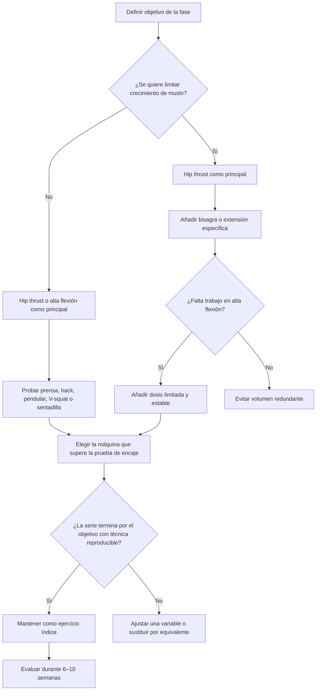

# Anexo G — Fase G3: matriz de selección de máquinas

Versión: 0.3  
Fecha: 2026-07-26  
Estado: matriz lista para personalizar; programación pendiente de G4

## 1. Propósito

Convertir G2 en decisiones de selección sin fingir que existe una máquina universalmente superior.

La matriz separa:

- calidad de evidencia;
- función dentro del programa;
- especificidad glútea probable;
- estabilidad;
- facilidad de progresión;
- fatiga sistémica;
- crecimiento colateral de cuádriceps, aductores y femorales;
- dependencia de la geometría y del ajuste individual.

No se suman las columnas para producir un ganador absoluto. Primero se aplican filtros de seguridad y encaje; después se ponderan los criterios según el objetivo.

## 2. Escalas

### Evidencia de hipertrofia glútea

| Puntuación | Significado |
|---:|---|
| 0 | No se localizó evidencia directa relevante |
| 1 | EMG, biomecánica o transferencia funcional |
| 2 | Evidencia general de modalidad o transferencia desde una variante próxima |
| 3 | Al menos un ensayo longitudinal directo sobre la familia |
| 4 | Evidencia longitudinal directa y convergente |

### Puntuaciones prácticas

| Dimensión | 1 | 3 | 5 |
|---|---|---|---|
| Especificidad | Baja para el músculo objetivo | Compartida | Muy concentrada |
| Estabilidad | El equilibrio limita fácilmente | Moderada | Muy alta |
| Progresión | Difícil de cuantificar | Utilizable | Muy precisa |
| Fatiga sistémica | Baja | Media | Alta |
| Crecimiento colateral | Pequeño | Moderado | Alto |
| Variabilidad de encaje | Poco dependiente del modelo | Intermedia | Muy dependiente de geometría y ajustes |

Las puntuaciones prácticas son inferencias para ordenar una prueba, no tamaños de efecto científicos.

## 3. Filtros obligatorios

Una opción se descarta antes de puntuar si:

- la trayectoria obliga a perder apoyo pélvico o control lumbar;
- el asiento, respaldo, eje o cinturón no puede ajustarse a la persona;
- aparece dolor creciente, pinzamiento, adormecimiento o presión intolerable;
- no existe una salida segura al aproximarse al fallo;
- el salto mínimo de carga impide progresar dentro de un rango razonable;
- otra región o el equilibrio terminan siempre la serie antes que la función buscada;
- el montaje no es reproducible entre sesiones.

La ausencia de dolor no demuestra que una máquina sea óptima; únicamente permite seguir evaluándola.

## 4. Jerarquía por función

### A. Extensión acortada

| Prioridad | Opción | Razón | Límite |
|---|---|---|---|
| Referencia científica | Hip thrust con barra | Evidencia longitudinal directa | Montaje y presión pélvica |
| Primera prueba de gimnasio | Plate-loaded o glute drive | Alta estabilidad y montaje potencialmente simple | Transferencia; depende mucho del modelo |
| Sustituto estable | Hip thrust en multipower | Carga precisa y menor demanda de equilibrio | Banco y guía pueden no encajar |

Regla: escoger **una** variante por bloque. Dos variantes de hip thrust en la misma sesión son volumen redundante salvo que una sea calentamiento no productivo.

### B. Alta flexión bilateral

| Prioridad | Opción | Razón | Límite |
|---|---|---|---|
| Evidencia directa | Prensa con rango tolerado | Hipertrofia directa de glúteo mayor | Alto crecimiento de muslo y geometría específica |
| Evidencia directa libre | Sentadilla profunda tolerada | Crecimiento glúteo y de pierna | Fatiga axial y técnica |
| Primera alternativa estable | Hack, pendular o V-squat que mejor encaje | Estabilidad y progresión | No existe comparación glútea directa entre ellas |
| Condicional | Belt squat | Menor carga sobre el tronco | Evidencia glútea débil y cinturón variable |

Regla: no decidir entre hack, pendular y V-squat por reputación. Gana temporalmente la que permita más rango útil, mejor limitante local, progresión fina y menor molestia.

### C. Alta flexión unilateral

| Prioridad | Opción | Uso |
|---|---|---|
| Primera prueba | Bulgarian o zancada inversa en multipower | Cuando el equilibrio limita la variante libre |
| Alternativa muy estable | Prensa unilateral | Cuando se desea comparar lados y reducir demanda de tronco |
| Alternativa libre | Step-up | Cuando la plataforma y la altura permiten estandarización |

El unilateral no corrige automáticamente una asimetría. Se comienza por el lado menos competente y se igualan repeticiones y carga; no se añade volumen extra sin una razón.

### D. Bisagra o extensión desde mayor flexión

| Prioridad | Opción | Uso |
|---|---|---|
| Referencia | RDL con barra | Cuando también interesa femoral y se tolera carga axial/agarre |
| Sustituto guiado | RDL en multipower | Cuando la estabilidad mejora el esfuerzo local |
| Sustituto apoyado | Hiperextensión a 45° | Cuando agarre o espalda limitan el RDL, siempre que no domine el movimiento lumbar |
| Secundaria | Pull-through | Cuando se busca poca carga axial y la polea permite progresar |
| Baja prioridad | Reverse hyper | Ausencia de ventaja glútea demostrada |

Regla: escoger un índice de bisagra. RDL pesado e hiperextensión pesada en la misma sesión suelen solaparse.

### E. Extensión específica

| Prioridad | Opción | Uso |
|---|---|---|
| Primera prueba | Máquina de patada/multi-hip que alinee bien el eje | Volumen local estable y fácil comparación lateral |
| Sustituto | Patada en polea con apoyo | Trayectoria ajustable y bajo coste de fatiga |

Son auxiliares. No sustituyen por defecto a todos los patrones principales.

### F. Abducción

| Prioridad | Opción | Uso |
|---|---|---|
| Primera prueba | Máquina sentada ajustable | Progresión simple y estabilidad |
| Sustituto | Polea o multi-hip de pie con apoyo | Comparación por lado y dirección ajustable |

La abducción se registra aparte. Su utilidad estética para plenitud superior o anchura sigue siendo una hipótesis que debe evaluarse mediante seguimiento.

## 5. Matriz resumida

La versión completa está en `datos/matriz_seleccion_G3.csv`.

| Familia | Evidencia | Especificidad glútea | Estabilidad | Fatiga sistémica | Colateral dominante | Papel |
|---|---:|---:|---:|---:|---|---|
| Hip thrust con barra | 4 | 5 | 4 | 2 | Bajo | Principal de referencia |
| Hip thrust máquina/multipower | 2 | 5 | 4–5 | 1–2 | Bajo | Principal si supera prueba de encaje |
| Prensa | 2–3 | 2–3 | 5 | 3 | Cuádriceps y aductor | Principal de pierna global |
| Sentadilla profunda | 4 | 3 | 2 | 5 | Cuádriceps y aductor | Principal global si se tolera |
| Hack/pendular/V-squat | 0–1 | 2–3 | 5 | 3 | Cuádriceps | Principal condicional |
| Bulgarian multipower | 1 | 4 | 4 | 4 | Cuádriceps | Principal unilateral |
| RDL | 1 | 3 | 2–4 | 3–4 | Femoral | Bisagra principal |
| Hiperextensión 45° | 1 | 4 | 4 | 2 | Femoral | Bisagra apoyada |
| Patada máquina/polea | 1 | 4–5 | 3–5 | 1 | Bajo | Auxiliar |
| Abducción máquina/polea | 1 | 4–5 para abductores | 3–5 | 1 | TFL variable | Auxiliar experimental |

## 6. Selectores por objetivo

### Máximo desarrollo del glúteo con mínima hipertrofia adicional de muslo

1. Una variante de hip thrust que supere la prueba de encaje.
2. Una bisagra: RDL o hiperextensión a 45°.
3. Una extensión específica: máquina o polea.
4. Una dosis limitada de alta flexión para cubrir esa función sin convertirla en el centro del programa.
5. Abducción opcional y registrada aparte.

Preferir: hip thrust, hiperextensión o RDL, patada.  
Limitar según respuesta: prensa, hack, pendular, sentadilla y Bulgarian.

### Máximo glúteo aceptando desarrollo global de pierna

1. Hip thrust.
2. Prensa, sentadilla, hack, pendular o V-squat que mejor encaje.
3. RDL o hiperextensión.
4. Extensión específica o abducción según volumen disponible.

### Plenitud superior y anchura visual

1. Mantener desarrollo general del glúteo mayor.
2. Añadir una abducción progresable durante un bloque estable.
3. Comparar fotografías estandarizadas y rendimiento.
4. Retirar la abducción si consume recuperación sin mejora medible.

No existe evidencia suficiente para prometer que inclinar el tronco o cambiar el respaldo de la máquina seleccione una región estética concreta.

### Espalda o agarre limitantes

Priorizar:

- hip thrust en máquina;
- prensa o sentadilla guiada con respaldo;
- patada en máquina;
- abducción sentada;
- hiperextensión solo si el tronco permanece controlado.

Reducir o sustituir:

- RDL libre pesado;
- sentadilla libre;
- variantes sin apoyo que terminen por agarre o estabilización.

### Rodilla sensible

No existe una máquina universalmente segura. Comenzar por las opciones que requieren menos flexión de rodilla —hip thrust, bisagra y extensión específica— y probar gradualmente prensa o guiadas solo si la técnica y los síntomas lo permiten. Dolor persistente o creciente requiere valoración profesional.

### Asimetría

Opciones preferentes:

- prensa unilateral;
- Bulgarian en multipower;
- patada unilateral;
- abducción unilateral.

La comparación debe conservar máquina, ajustes, rango, carga, repeticiones y RIR.

### Poco tiempo

Orden mínimo:

1. hip thrust o prensa, según prioridad estética;
2. segunda función distinta: alta flexión o bisagra;
3. auxiliar solo si queda tiempo y recuperación.

No usar una colección de máquinas auxiliares para sustituir dos patrones principales progresables.

## 7. Árbol de decisión

## 8. Prueba de encaje en tres exposiciones

### Exposición 1 — Geometría

- Carga ligera y 3–4 RIR.
- Registrar asiento, respaldo, plataforma, topes, cinturón, banco y orientación.
- Buscar rango estable, salida segura y ausencia de compensaciones obligadas.
- Probar solo uno o dos ajustes; no cambiar todo simultáneamente.

### Exposición 2 — Serie productiva controlada

- Dos series en el rango previsto, normalmente 8–15 o 10–20 repeticiones.
- Mantener 2–3 RIR.
- Registrar qué región limita, estabilidad, molestias y calidad del rango.

### Exposición 3 — Repetibilidad

- Repetir los mismos ajustes.
- Comprobar si carga, repeticiones y RIR son comparables.
- Revisar recuperación y síntomas del día siguiente.

### Aceptar como ejercicio índice si

- la configuración puede reproducirse;
- el rango útil es estable;
- la función buscada participa como limitante;
- existe una vía clara de progresión;
- no aparece dolor creciente ni compensación obligada;
- la logística es compatible con el gimnasio habitual.

### Rechazar o relegar si

- necesita ajustes improvisados cada sesión;
- el acolchado o cinturón limita antes que el músculo;
- la trayectoria no encaja con la cadera, rodilla o espalda;
- el salto mínimo de carga destruye el rango de repeticiones;
- otra opción equivalente obtiene mejor resultado con menos coste.

La plantilla se encuentra en `datos/plantilla_prueba_encaje_G3.csv`.

## 9. Redundancias

| Grupo | Elegir por sesión | Redundancia habitual |
|---|---:|---|
| Hip thrust | 1 | Barra + multipower + glute drive |
| Alta flexión bilateral | 1 | Prensa + hack + pendular |
| Alta flexión unilateral | 0–1 | Bulgarian + prensa unilateral + step-up |
| Bisagra | 1 | RDL + hiperextensión + pull-through pesados |
| Extensión específica | 0–1 | Patada en polea + máquina de patada |
| Abducción | 0–1 | Máquina sentada + polea + multi-hip |

Pueden coexistir variantes del mismo grupo en días diferentes si existe una razón, pero primero se debe justificar por función, tolerancia o distribución de fatiga.

La tabla completa de equivalencias está en `datos/equivalencias_redundancias_G3.csv`.

## 10. Sustituciones rápidas

| Si falla | Sustituir primero por | Función conservada |
|---|---|---|
| Hip thrust máquina | Multipower o barra | Extensión acortada |
| Prensa | Hack, pendular o sentadilla guiada | Alta flexión bilateral |
| Hack/pendular | Prensa o Bulgarian multipower | Alta flexión |
| RDL | Hiperextensión a 45° o pull-through | Bisagra |
| Bulgarian | Prensa unilateral o zancada guiada | Alta flexión unilateral |
| Patada máquina | Patada en polea con apoyo | Extensión específica |
| Abducción sentada | Polea o multi-hip con apoyo | Abducción |

La sustitución conserva función, no necesariamente curva de resistencia, carga o respuesta individual.

## 11. Resultado de G3

G3 resuelve la selección a nivel de familia y crea el procedimiento para elegir una máquina real. No prescribe todavía series semanales ni distribución definitiva; eso corresponde a G4.

> **HITO GIMNASIO — MATRIZ LISTA PARA PERSONALIZAR**

Para personalizar bastará con:

- identificar qué equipos están disponibles;
- registrar marca/modelo o fotografías;
- completar tres exposiciones de prueba para los candidatos prioritarios;
- elegir si se desea mínimo crecimiento adicional de muslo o desarrollo global de pierna.

