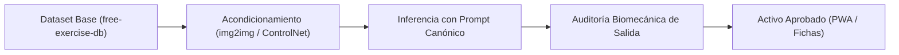

# Guía Gráfica de Ilustración de Ejercicios y Movimientos

Versión 1.0 · 2026-10-23.  
Estándar visual, banco de prompts y protocolo de inferencia/auditoría para la generación de láminas técnicas anatómicas del sistema.

---

## 1. Identidad Visual y Estilo Canónico

El objetivo visual no es el fotorrealismo ni la estética de cómic, sino el estándar de **manual técnico de instrucción física y lámina médica funcional**:
- **Fondo:** Blanco puro sin artefactos ni fondos de gimnasio (`white background, no background clutter`).
- **Trazo:** Línea vectorial limpia y minimalista en tinta negra (`clean, minimalist vector line-art schematic illustration, black lines`).
- **Sujeto:** Precisión anatómica humana, figura masculina aislada ejecutando el movimiento biomecánico exacto (`anatomical accuracy, fitness instructional style`).
- **Elementos:** Exclusivamente la figura humana y el implemento/estación imprescindible (mancuerna, kettlebell, barra, cajón, polea).

---

## 2. Fórmula del Prompt (Estructura Canónica)

Para asegurar reproducibilidad y coherencia entre distintas series y modelos generativos, cada prompt debe ajustarse a esta plantilla:

```text
A clean, minimalist vector line-art schematic illustration of a man doing [EJERCICIO ESPECÍFICO], exactly matching the posture in the reference image. White background, black lines, anatomical accuracy, fitness instructional style. No background clutter, just the figure and [EQUIPAMIENTO / IMPLEMENTO].
```

### Modificadores y Roles

| Componente | Prompt Chunk | Función |
| :--- | :--- | :--- |
| **Estilo base** | `clean, minimalist vector line-art schematic illustration` | Elimina sombras complejas, texturas de piel o degradados; fuerza trazo vectorial. |
| **Lienzo** | `white background, black lines, no background clutter` | Aísla la figura en alto contraste para integración limpia en UI / PWA. |
| **Criterio anatómico** | `anatomical accuracy, fitness instructional style` | Condiciona proporciones realistas y lectura biomecánica instructiva. |
| **Fidelidad postural** | `exactly matching the posture in the reference image` | Ancla la inferencia a la imagen condicionante visual (ControlNet / img2img). |
| **Composición** | `just the figure and [EQUIPAMIENTO]` | Evita elementos fantasma (suelos de goma, espejos, bancos innecesarios). |

---

## 3. Banco de Prompts Validados

Prompts exactos probados con resultado consistente:

| Ejercicio | Prompt Validado | Implemento |
| :--- | :--- | :--- |
| **Goblet Squat** | `A clean, minimalist vector line-art schematic illustration of a man doing a goblet squat, exactly matching the posture in the reference image. White background, black lines, anatomical accuracy, fitness instructional style. No background clutter, just the figure and the kettlebell.` | Kettlebell |
| **Dumbbell Bench Press** | `A clean, minimalist vector line-art schematic illustration of a man doing a Dumbbell Bench Press, exactly matching the posture in the reference image. White background, black lines, anatomical accuracy, fitness instructional style. No background clutter.` | Mancuernas / Banco |
| **Seated Arnold Press** | `A clean, minimalist vector line-art schematic illustration of a man doing a seated Dumbbell Arnold Press, exactly matching the posture in the reference image. White background, black lines, anatomical accuracy, fitness instructional style. No background clutter.` | Mancuernas / Banco sentado |
| **Barbell Step Up** | `A clean, minimalist vector line-art schematic illustration of a man doing a Barbell Step Up on a box, exactly matching the posture in the reference image. White background, black lines, anatomical accuracy, fitness instructional style. No background clutter.` | Barra / Cajón |
| **Pallof Press** | `A clean, minimalist vector line-art schematic illustration of a man doing a Pallof Press with a cable machine, exactly matching the posture in the reference image. White background, black lines, anatomical accuracy, fitness instructional style. No background clutter.` | Polea / Cable |
| **Dead Bug** | `A clean, minimalist vector line-art schematic illustration of a man doing a Dead Bug exercise on the floor, exactly matching the posture in the reference image. White background, black lines, anatomical accuracy, fitness instructional style. No background clutter.` | Suelo (peso corporal) |

---

## 4. Pipeline de Inferencia a Escala

Para generación programática o por lotes de los ejercicios del catálogo:



### 4.1. Ground Truth Postural (Dataset Base)
- **Repositorio fuente:** [`yuhonas/free-exercise-db`](https://github.com/yuhonas/free-exercise-db).
- **Estructura canónica de URLs:**  
  `https://raw.githubusercontent.com/yuhonas/free-exercise-db/main/exercises/[Exercise_Name]/[0|1].jpg`
  - `0.jpg`: Posición inicial / fase de partida.
  - `1.jpg`: Posición final / pico de contracción concéntrica.

### 4.2. Inferencia Condicionada (Image-to-Image / ControlNet)
- **Regla estricta:** No generar imágenes desde texto puro (text-to-image libre) para ejercicios técnicos.
- **Mecanismo:** Pasar la imagen de referencia (`0.jpg` o `1.jpg`) como condicionamiento visual multimodal (OpenPose, Canny/Lineart o img2img con denoising moderado 0.5–0.7).
- **Objetivo:** Forzar la cinemática articular real y evitar que el generador invente ángulos articulares anómalos o trayectorias lesivas.

---

## 5. Protocolo de Auditoría Biomecánica (Checklist de Salida)

Toda imagen generada debe superar una inspección visual de 4 puntos ciegos antes de ser admitida como recurso del sistema:

1. **Inserciones musculares fantasma:**
   - Verificar la ausencia de relieves o vientres musculares en zonas anatómicamente imposibles (especialmente caja torácica, deltoides anterior/lateral y unión clavicular).
2. **Anclaje de elementos externos:**
   - Comprobar que cables de poleas, bandas elásticas y barras no atraviesen segmentos corporales ni floten desconectados del origen mecánico.
3. **Agarres y conteo de dedos:**
   - Inspección rigurosa de palmas, muñecas y manos sujetando mancuernas, barras o asas de kettlebell (máximo 5 dedos por mano, pulgar en oposición anatómica real).
4. **Disposición de raquis y cuello neutro:**
   - Descartar hiperextensiones cervicales forzadas en sentadillas/bisagras o curvaturas lumbares invertidas bajo carga.

---

## 6. Vinculación con el Sistema Canónico

Las imágenes aprobadas se mapearán contra los IDs estandarizados de `data/indicaciones_tecnicas.json` y `data/catalogos.json`:
- Formato de nomenclatura recomendado: `assets/ejercicios/[ID_EJERCICIO]_[fase:inicio|final].webp` (ej. `G01_inicio.webp`, `G01_final.webp`).
