# Dossier Técnico y Visual para Auditoría Externa — DameCañaTN (Edición Titanio Nocturno)

**Fecha de generación:** 29 de octubre de 2026  
**Objetivo del documento:** Proveer a una IA auditora externa una especificación exhaustiva de la arquitectura, contratos de datos, flujo funcional, catálogo completo de pantallas (con 14 capturas reales en viewport móvil `412×915` DPR 2 — Samsung Galaxy S24 Ultra) y hallazgos preliminares de UI/CSS detectados durante la inspección.

---

## 1. Propósito del Sistema y Filosofía de Diseño

**DameCañaTN** (`DameCañaTN/` y desplegada en `/tn/`) es una Progressive Web App (PWA) 100% local-first diseñada para registrar entrenamientos de fuerza e hipertrofia con una sola mano en el gimnasio (optimizada para Samsung Galaxy S24 Ultra).

### 1.1. División de Responsabilidades (Entrenador IA vs. App)
- **Lo que hace el Entrenador IA (sistema central en local):** Analiza fatiga, historial biomecánico, adherencia y literatura científica para prescribir la sesión del día mediante un formato textual determinista llamado **Note v1** (`# Día A/B/C/D/E`).
- **Lo que hace la App (`DameCañaTN`):**
  1. **Interpreta** la nota del entrenador (`parser.js`) o carga plantillas precompiladas desde el programa activo (`day-templates.js`).
  2. **Presenta** la sesión en un entorno táctil 3D (**APEX Stealth Chrono-Lab**: acabado en Titanio Grado 5 cepillado, carbono forjado, pulsadores moleteados 3D, acrílico ámbar translúcido y hologramas musculares termográficos).
  3. **Registra** series efectivas (carga, repeticiones, RIR, notas técnicas e identidad exacta de máquina/estación) sin autorrellenar jamás repeticiones ni RIR no ejecutados.
  4. **Conserva y sincroniza** en `localStorage` y mediante una cola de sincronización asíncrona (`sync-queue.js`) hacia Google Apps Script / Google Drive, además de exportar archivos compatibles con los contratos `training_log.v1`, `training_history.v1` y `checkin.v1`.
- **Lo que la App TIENE PROHIBIDO hacer:** No inventa programas, no altera ejercicios sin acción humana, no prescribe cargas por su cuenta ni compara cargas entre estaciones cuya identidad biomecánica (`resistanceMode`, `variant`, `loadBasis`) no sea equivalente.

---

## 2. Arquitectura Técnica y Mapa de Archivos

La aplicación opera sin frameworks pesados de estado en tiempo de ejecución (Vanilla ES6+ modularizado en scripts IIFE/UMD) sobre un documento principal (`index.html`) y una vista independiente de biofeedback (`checkin.html`).

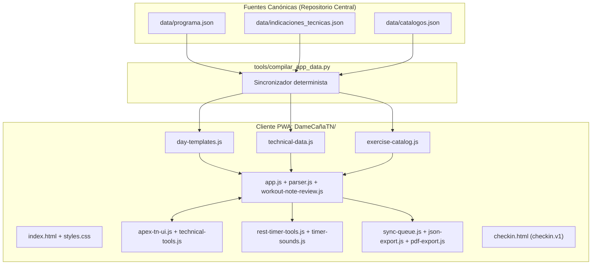

### Mapa de módulos (`DameCañaTN/`)
| Archivo | Rol y Responsabilidad |
|---|---|
| `index.html` | Estructura DOM única de 5 pantallas (`#importScreen`, `#workoutNoteReviewScreen`, `#sessionScreen`, `#historyScreen`, `#historicalScreen`), dock fijo inferior y 5 diálogos modales nativos `<dialog>`. |
| `styles.css` | Sistema de diseño **Titanio Nocturno** (~3.313 líneas): placas con tornillos hexagonales, botones moleteados (`data-knurled-tone`), pozos OLED, perspectiva 3D y horizonte láser de descanso. |
| `apex-tn-ui.js` | Motor espacial y táctil: carrusel 3D interactivo (`perspective: 1200px`), inyección de hologramas musculares termográficos (`MUSCLE_HOLOGRAMS`), rodillo táctil moleteado (`±15s`), bobinas de cinta animadas y dock de navegación con Popover V3. |
| `app.js` | Núcleo de estado y persistencia (`localStorage` bajo clave `registro-entrenamiento-v1` / `workoutTracker_state_v1`), ciclo de vida de la sesión, emparejamiento de referencias históricas comparables y eventos de formularios. |
| `parser.js` | Analizador léxico/sintáctico de la nota del entrenador (**Note v1**): extrae título, día (`A–E`), ejercicios, prescripción de series/reps/RIR/descanso, alertas del entrenador (`coachCue`) y modo de resistencia. |
| `workout-note-review.js` | Pantalla intermedia de auditoría de la nota parseada antes de instanciar la sesión activa. |
| `technical-tools.js` + `technical-data.js` | Motor de giro 3D de tarjetas (Flip 180° en eje Y) e inyección de fichas biomecánicas (zona principal, configuración de máquina, objetivo técnico, variantes y errores frecuentes). |
| `exercise-catalog.js` + `exercise-metadata.js` | Catálogo taxonómico de ejercicios por grupo muscular y reglas de inferencia de identidad (`external`, `bodyweight`, `trx`, `loadBasis`). |
| `rest-timer-tools.js` + `timer-sounds.js` | Cronógrafo de descanso basado en marcas de tiempo (`Date.now()`) resistente a bloqueo de pantalla, con síntesis Web Audio API (`sport_horn`, `clean_bell`, `deep_pulse`). |
| `sync-queue.js` + `gem-command-tools.js` | Cola offline-first de envío a Google Drive/Sheets y ejecutor de comandos JSON estructurados provenientes del Gem/Entrenador IA. |
| `json-export.js` + `pdf-export.js` | Generadores de payloads `training_log.v1` / `training_history.v1` y documentos PDF mediante `pdf-lib`. |
| `checkin.html` | Aplicación acoplada para el seguimiento semanal (`checkin.v1`): sueño, recuperación, antropometría y mapa de dolor/incidencias. |

---

## 3. Recorrido Exhaustivo por Pantallas y Modales (Con Capturas)

### 3.1. Pantalla 1: Inicio Rápido y Placa de Diales (`#importScreen` — Parte Superior)
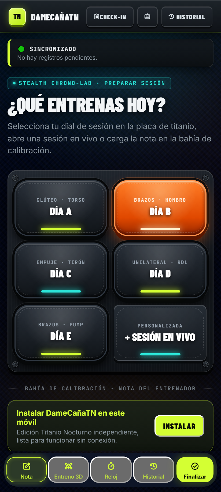

- **Cabecera Global (`.app-header`):**
  - Marca `TN · DAMECAÑATN` con botón de retorno a inicio (`#goHome`).
  - Tres accesos directos: `Check-in` (abre `checkin.html`), icono de robot `IA` (abre modal `#gemCommandDialog`) y botón `Historial` (navega a `#historyScreen`).
- **Tarjeta Global de Sincronización (`#syncStatusCard`):**
  - Muestra en tiempo real el estado de la cola `sync-queue.js`: `🟢 SINCRONIZADO` (sin pendientes), `🟡 PENDIENTE DE ENVÍO` (guardado en local esperando red) o `🔴 ERROR DE SINCRONIZACIÓN` (con botón `Reintentar`).
- **Placa de Inicio Rápido 3×2 (`.quick-start-grid`):**
  - Placa metálica con 4 tornillos hexagonales y 6 pulsadores táctiles 3D: **Día A** (Glúteo · Torso), **Día B** (Brazos · Hombro), **Día C** (Empuje · Tirón), **Día D** (Unilateral · RDL), **Día E** (Brazos · Pump) y **+ Sesión en vivo** (crea sesión en blanco).
  - **Lógica inteligente de recomendación (`highlightRecommendedDayDial` en `apex-tn-ui.js`):** Lee el último día registrado en `localStorage` dentro del ciclo `A → B → C → D → E` e ilumina automáticamente en **acrílico ámbar translúcido** (`data-knurled-tone="amber"`, `data-recommended="true"`) el siguiente día que toca entrenar (en la captura, como la última sesión del historial de prueba fue Día A, ilumina automáticamente **Día B** en ámbar).
- **Tarjeta PWA (`#installCard`):** Banner contextual para instalar la PWA en el sistema operativo móvil cuando se detecta `beforeinstallprompt`.
- **Dock Inferior Fijo (`#bottom-nav-dock`):** Barra estilo glassmorphism con 5 acciones persistentes: `Nota`, `Entreno 3D`, `Reloj`, `Historial` y `Finalizar`.

---

### 3.2. Pantalla 1 (Scroll Inferior): Bahía de Calibración — Nota del Entrenador (`#importScreen`)
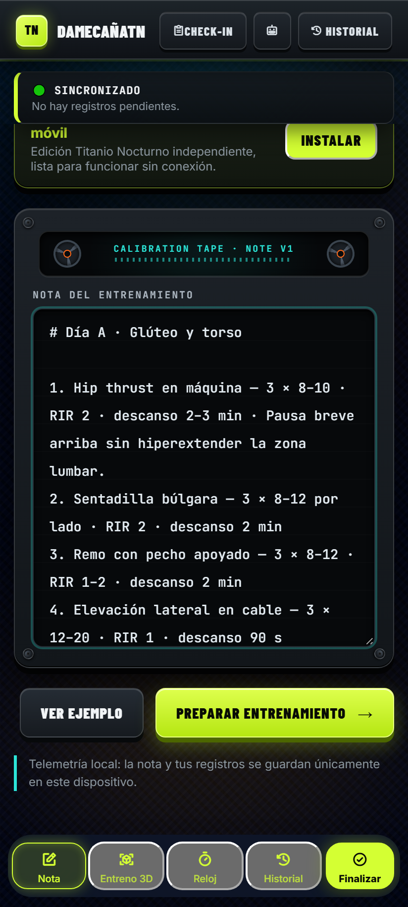

- **Chasis de Cinta de Calibración (`.tape-deck-housing`):**
  - Incluye dos bobinas mecánicas (`#tapeReelLeft` y `#tapeReelRight`) con la leyenda `CALIBRATION TAPE · NOTE V1` que giran físicamente mediante transformaciones CSS cada vez que el usuario escribe, pega texto o carga una plantilla (`initTapeDeckReels`).
- **Área de texto (`#trainerNote`):**
  - Recibe el bloque **Note v1** prescrito por el entrenador IA.
  - Botones de acción: `Ver ejemplo` (carga una nota de demostración) y `Preparar entrenamiento →` (`#parseButton`), que ejecuta `parser.js` y conduce a la pantalla de revisión previa.

---

### 3.3. Pantalla 2: Revisión Previa del Entrenamiento (`#workoutNoteReviewScreen`)
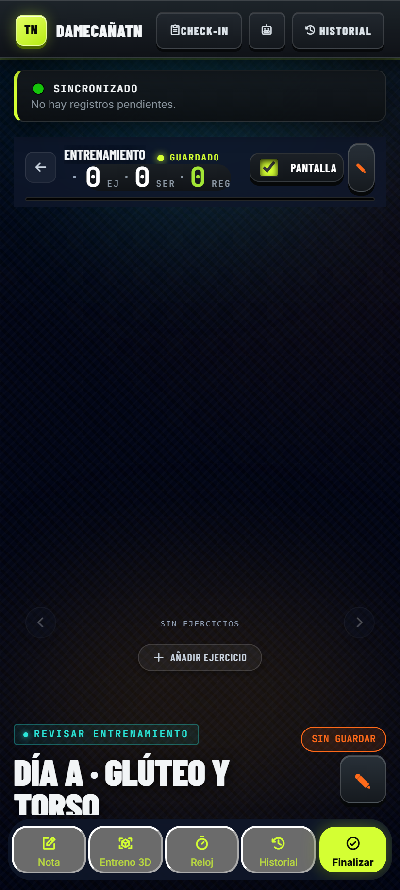

- **Propósito funcional:** Actúa como esclusa de verificación antes de abrir la sesión activa. Nada se guarda como sesión en curso hasta que el usuario confirma.
- **Elementos clave:**
  - Etiqueta de estado `SIN GUARDAR`, título detectado (`Día A · Glúteo y torso`), fecha asignada y píldoras resumen (`4 ejercicios`, `12 series previstas`).
  - Lista de tarjetas pre-auditadas (`#workoutNoteReviewList`) mostrando para cada ejercicio: número de orden, nombre canónico, series prescritas, rango de repeticiones, RIR objetivo, tiempo de descanso y notas técnicas extraídas.
  - Barra de acciones inferior: `Editar nota` (regresa al textarea conservando el texto) o `Crear sesión →` (`#workoutNoteReviewConfirm`, instancia la sesión y abre el carrusel 3D).

---

### 3.4. Pantalla 3: Sesión Activa — Carrusel 3D y Anverso de Tarjeta (`#sessionScreen`)
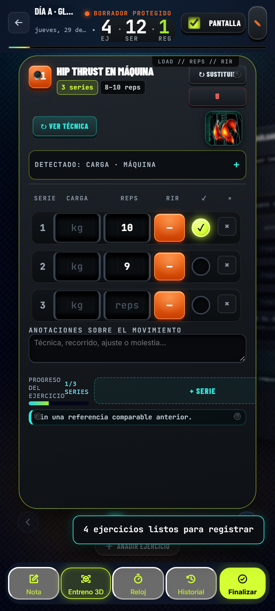

Al entrar en `#sessionScreen`, la cabecera general se oculta para maximizar el espacio vertical y entra en acción el **HUD de Sesión Activa**:
- **Barra Superior Compacta (`.session-top-hud`):**
  - Botón `←` para volver al inicio, título truncado de la sesión, insignia de estado (`BORRADOR PROTEGIDO` en ámbar o `GUARDADO` en verde), fecha y contadores de telemetría en vivo: **`4 EJ · 12 SER · 1 REG`**.
  - Conmutador `PANTALLA` (**Screen Wake Lock API**): evita que el teléfono apague la pantalla entre series.
  - Botón lápiz `✎` (`#editNoteButton`): permite regresar a corregir la nota fuente.
  - Barra fina de progreso multicolor (`#progressBar`) que avanza conforme se marcan series con `✓`.
- **Escenario del Carrusel 3D (`#carousel-stage`):**
  - Contenedor con `perspective: 1200px` y `transform-style: preserve-3d`.
  - Navegación por arrastre táctil horizontal (`touchstart`/`touchmove` con bloqueo de eje X/Y para no interferir con el scroll vertical de las series), botones `<` / `>`, puntos de paginación (`#pagination-dots`) o teclas de dirección.
  - Las tarjetas adyacentes se desplazan en 3D (`translate3d`, `rotateY(±25deg)`, `scale`, `blur` progresivo) y las luces ambientales de fondo (`#ambient-orb-primary` / `#ambient-orb-secondary`) cambian de color según el progreso de la tarjeta activa.
- **Anatomía de la Tarjeta de Ejercicio (Anverso `.exercise-front`):**
  - **Cabecera (Capa Z-10):** Índice en placa ámbar/cian (`1`), nombre del ejercicio, píldoras de prescripción (`3 series`, `8-10 reps`), botones `↻ SUSTITUIR` y papelera `🗑`.
  - **Franja Biomecánica y Holograma Termográfico 3D (`.tn-bio-strip`):**
    - Botón `↻ VER TÉCNICA` a la izquierda.
    - A la derecha, **Bahía de Holograma Muscular (`tn-hologram-bay`)**: detecta automáticamente el grupo muscular o porción anatómica del ejercicio (`detectMuscleGroup` en `apex-tn-ui.js`: glúteo mayor, pectoral clavicular/esternal, deltoides lateral/posterior, cabeza larga del tríceps/bíceps, cuádriceps, isquiosurales, dorsal, etc.) y renderiza su holograma termográfico infrarrojo WebP junto con su código técnico (`IR-GL01`).
  - **Tabla de Series (Capa Z-30):**
    - Filas por cada serie con: número de serie, pozo OLED para **CARGA (`kg`)**, pozo OLED para **REPS**, selector táctil de **RIR** en acrílico ámbar (`0`, `1`, `2`, `3`, `4+`), botón circular de completado **`✓`** (se ilumina en verde lima neón al marcarse) y botón `×` para eliminar serie.
  - **Anotaciones sobre el movimiento:** Campo de texto libre por ejercicio para registrar sensaciones, topes o molestias.
  - **Pie de Tarjeta (Capa Z-20):** Barra de progreso individual del ejercicio (`1/3 SERIES`), botón `+ SERIE` y caja de **Referencia Histórica Comparable** (muestra la última sesión válida con igual modo de resistencia y permite copiar sus cargas con un toque si existe).

---

### 3.5. Pantalla 3 (Interacción): Reverso 3D de Tarjeta — Ficha Biomecánica
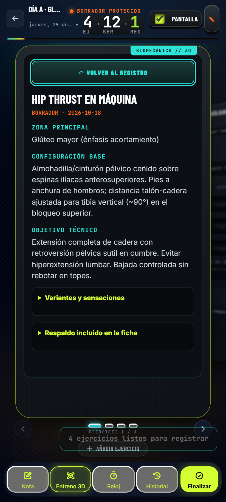

- **Cómo se activa:** Pulsando sobre `↻ VER TÉCNICA` o directamente sobre el **Holograma Muscular Termográfico 3D**.
- **Comportamiento (`technical-tools.js`):**
  - La tarjeta ejecuta una rotación 3D de `180deg` en el eje Y (`rotateY(180deg)`) con `backface-visibility: hidden` y muestra el reverso (`BIOMECÁNICA // 3D`).
  - Consulta la base de conocimiento compilada en `technical-data.js` (proveniente de `data/indicaciones_tecnicas.json`) y presenta:
    1. **Zona Principal:** Músculo y énfasis biomecánico (ej. *Glúteo mayor — énfasis acortamiento*).
    2. **Configuración Base:** Ajustes anatómicos y mecánicos de la estación.
    3. **Objetivo Técnico:** Pautas de ejecución, control excéntrico y rango de movimiento.
    4. **Desplegables adicionales:** *Variantes y sensaciones* y *Respaldo incluido en la ficha*.
  - Botón superior `↶ VOLVER AL REGISTRO` para devolver la tarjeta a su cara frontal de anotación.

---

### 3.6. Pantalla 3 (Detalle): Identidad de Máquina y Navegación del Carrusel
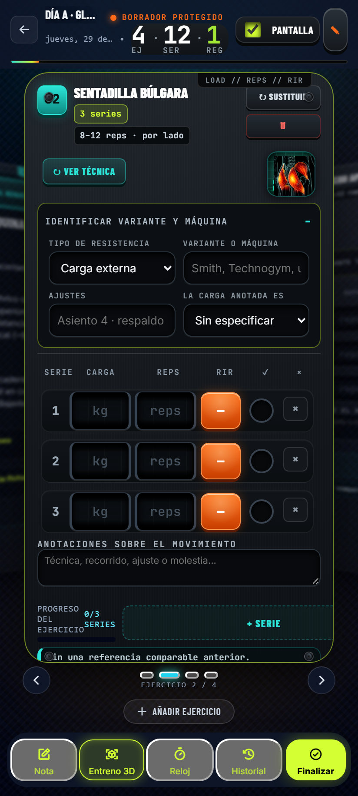

- **Acordeón de Identificación de Variante y Máquina (`details.exercise-identity`):**
  - Garantiza uno de los contratos más importantes del sistema: **no mezclar cargas incomparables**.
  - Permite especificar:
    - **Tipo de resistencia:** `Carga externa`, `Autocarga` o `TRX` (cambia automáticamente la etiqueta de la columna `KG` a `PESO` o `MODO/INCLINACIÓN`).
    - **Variante o máquina:** Ej. *Smith, Technogym, Hammer Strength, unilateral*.
    - **Ajustes:** Ej. *Asiento 4 · respaldo 2*.
    - **La carga anotada es (`loadBasis`):** `Sin especificar`, `Carga total`, `Carga por lado`, `Peso añadido` o `Marcador de la máquina`.
- En la parte inferior se observa también el **Cronógrafo de Descanso** minimizado corriendo en vivo (`01:58`) y la barra superior ambiental láser (`AMBIENT REST · 01:58`).

---

### 3.7. Modal: Catálogo y Selector de Ejercicios (`#exercisePickerDialog`)
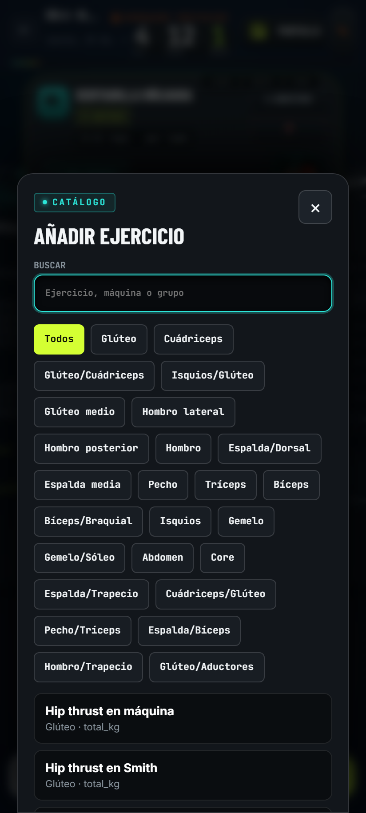

- **Cómo se activa:** Pulsando `+ AÑADIR EJERCICIO` bajo el carrusel o `↻ SUSTITUIR` en la cabecera de cualquier tarjeta.
- **Funcionamiento:**
  - Campo de búsqueda instantánea (`#exercisePickerSearch`) que filtra por nombre de ejercicio, máquina o grupo muscular.
  - Píldoras de filtro rápido por grupo/subgrupo anatómico (`Todos`, `Glúteo`, `Cuádriceps`, `Isquios/Glúteo`, `Hombro lateral`, `Espalda/Dorsal`, etc.).
  - Lista de resultados con metadatos de grupo y modo de conteo de carga (`total_kg`, `per_side_kg`, `machine_stack_kg`).
  - Opción inferior `+ Escribir ejercicio personalizado` por si el usuario usa una máquina nueva fuera de catálogo.

---

### 3.8. Componente Global: Cronógrafo de Descanso Moleteado y Panel de Sonido (`#restDock` + `#restTimerPanel`)
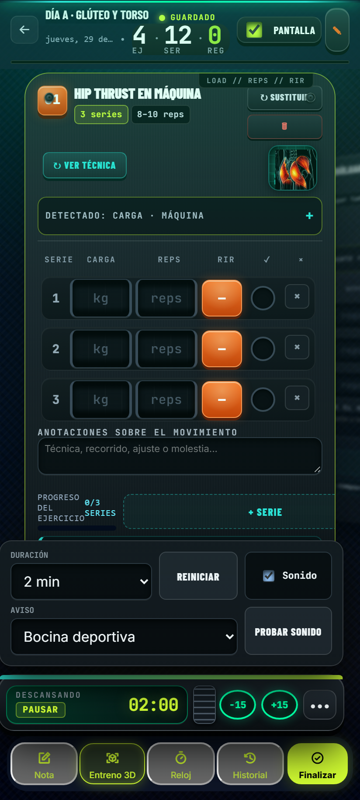

- **Activación y Visibilidad:** Se muestra al pulsar el botón `Reloj` en el dock inferior (`[data-dock-action="timer"]`).
- **Controles táctiles de precisión:**
  - **Botón principal OLED (`#restTimerButton`):** Inicia/pausa la cuenta atrás (`02:00`) con barra de progreso superior y **Horizonte Láser Ambiental** en el borde superior de la pantalla (`#restAmbient`).
  - **Rodillo Táctil Moleteado (`#tnKnurledRoller`):** Control deslizante vertical con textura mecánica animada que suma o resta `±15 s` al deslizar el pulgar hacia arriba o abajo.
  - **Anillos Neón (`−15` / `+15`):** Ajuste rápido por toque directo.
  - **Panel Desplegable (`•••` → `#restTimerPanel`):** Permite cambiar la duración base (`15 s` a `4 min`), reiniciar el reloj, activar/desactivar sonido y elegir el perfil acústico sintetizado (`Bocina deportiva`, `Campana limpia`, `Pulso grave`) con botón `PROBAR SONIDO`.

---

### 3.9. Menú de Cierre de Sesión: Popover V3 (`#finishPopover`)
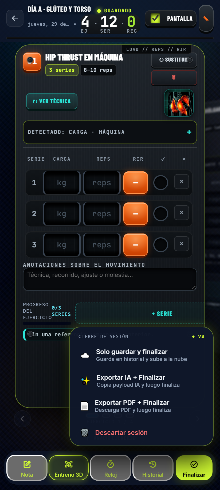

- **Cómo se activa:** Pulsando el botón verde lima `Finalizar` (`#dockFinishBtn`) en el extremo derecho del dock inferior.
- **Cuatro flujos de salida integrados:**
  1. **`☁️ Solo guardar y finalizar`:** Valida que haya al menos una serie con repeticiones registradas, guarda la sesión en el historial local (`localStorage`) y la encola en `sync-queue.js` para subirla a Google Drive/Sheets.
  2. **`✨ Exportar IA + Finalizar`:** Genera y copia/comparte el payload JSON `training_log.v1` para entregárselo al Entrenador IA y acto seguido finaliza la sesión.
  3. **`📄 Exportar PDF + Finalizar`:** Genera en el dispositivo un informe PDF limpio mediante `pdf-lib` (`pdf-export.js`), lo descarga y cierra la sesión.
  4. **`🗑️ Descartar sesión`:** Elimina el borrador activo previa confirmación en diálogo modal (`#confirmDialog`).

---

### 3.10. Pantalla 4: Historial y Archivo de Telemetría (`#historyScreen`)
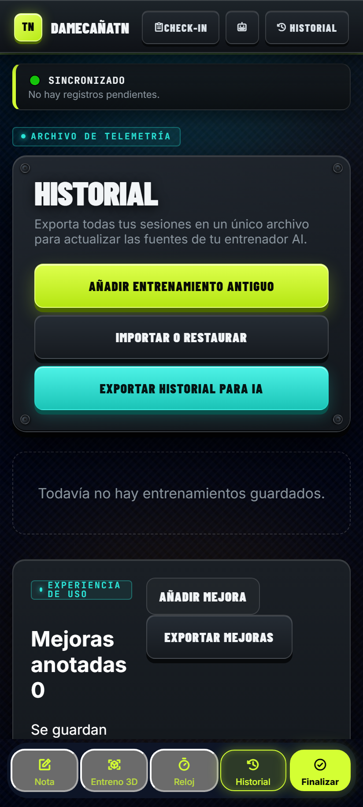

- **Sección Superior — Archivo de Telemetría:**
  - Tres acciones maestras:
    - **`AÑADIR ENTRENAMIENTO ANTIGUO`** (abre `#historicalScreen`).
    - **`IMPORTAR O RESTAURAR`** (permite cargar un archivo `.json` de respaldo sin borrar las sesiones locales existentes, fusionando por `id`).
    - **`EXPORTAR HISTORIAL PARA IA`** (exporta todas las sesiones bajo el esquema `training_history.v1`).
  - Listado cronológico de sesiones cerradas (`#historyList`) con detalle expandible de ejercicios, series y exportación individual.
- **Sección Inferior — Experiencia de Uso (`Mejoras anotadas`):**
  - Cuaderno de bitácora UX integrado en la propia app para que el usuario anote fricciones reales mientras entrena en el gimnasio (`feedback-tools.js`), exportable en un archivo independiente.

---

### 3.11. Modal: Registro de Mejoras de UX (`#feedbackDialog`)
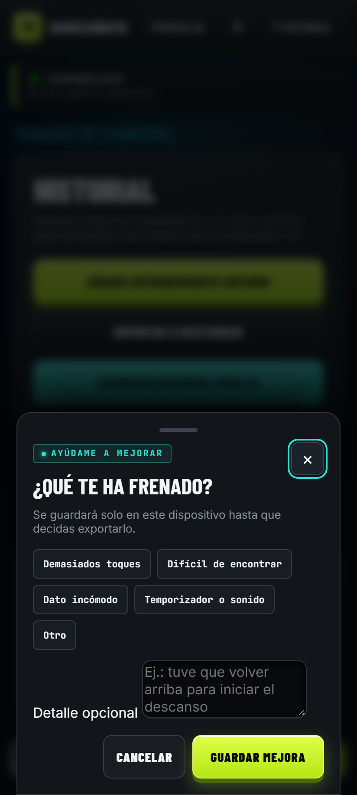

- Se abre desde `AÑADIR MEJORA` en la pantalla de Historial.
- Permite clasificar rápidamente la fricción en el gimnasio con una sola mano: `Demasiados toques`, `Difícil de encontrar`, `Dato incómodo`, `Temporizador o sonido` u `Otro`, más un campo de comentario libre.

---

### 3.12. Pantalla 5: Importación Manual de Entrenamientos Antiguos (`#historicalScreen`)
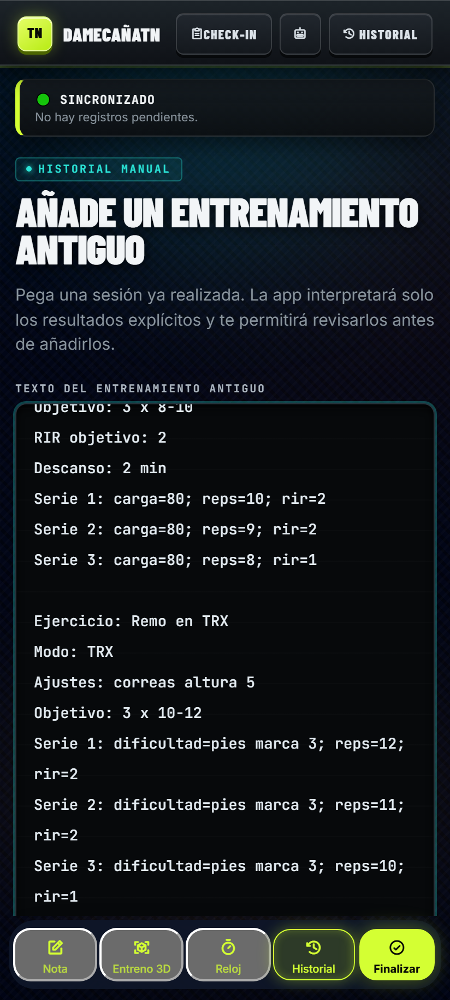

- **Propósito (`historical-parser.js`):** Permite incorporar al historial sesiones realizadas en el pasado a partir de texto estructurado (`Fecha:`, `Entrenamiento:`, `Ejercicio:`, `Modo:`, `Serie N: carga=...; reps=...; rir=...`).
- **Garantía de integridad:** Solo interpreta resultados explícitos y conduce a la vista de sesión en modo borrador histórico (`#historicalDraftBanner`) para revisión humana antes de guardarse en el historial definitivo.

---

### 3.13. Modal: Atajo de Entrenador — Comandos IA (`#gemCommandDialog`)
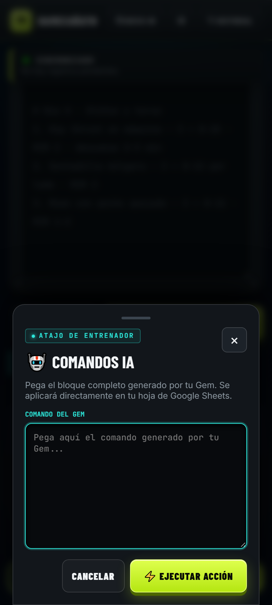

- **Cómo se activa:** Pulsando el icono de robot `🤖 IA` en la cabecera superior.
- **Propósito (`gem-command-tools.js`):** Permite pegar un bloque JSON de comandos generado por el Gem / Entrenador IA y enviarlo directamente al endpoint de Google Apps Script para actualizar hojas de cálculo en Google Sheets desde el móvil (`⚡ EJECUTAR ACCIÓN`).

---

### 3.14. Pantalla Independiente: Check-in Semanal y Biofeedback (`checkin.html`)
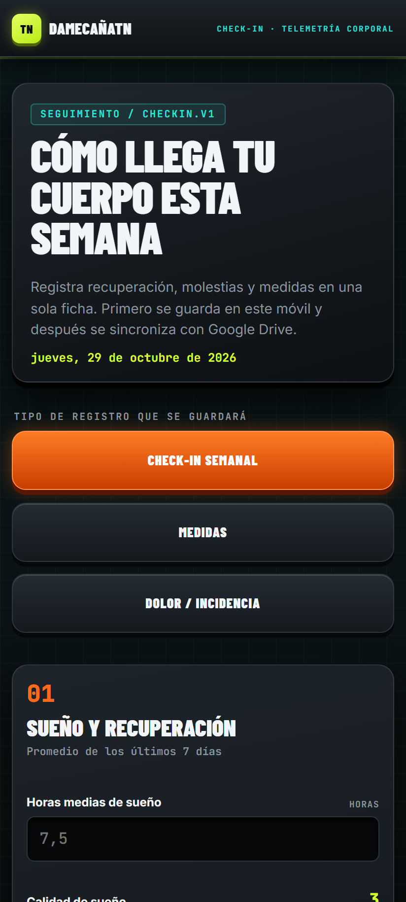

- **Propósito:** Ficha unificada bajo contrato `checkin.v1` con estética Titanio Nocturno para registrar el estado biológico semanal del atleta.
- **Tres modos de registro seleccionables:** `CHECK-IN SEMANAL`, `MEDIDAS` o `DOLOR / INCIDENCIA`.
- **Bloques de captura:**
  1. **Sueño y Recuperación:** Horas medias de sueño, calidad subjetiva (`1–5`), energía general y estrés.
  2. **Adherencia y Sensaciones:** Cumplimiento nutricional, digestión, congestión/pump y agujetas (DOMS).
  3. **Molestias o Dolor Articular:** Localización, intensidad (`0–10`), patrón mecánico y notas.
  4. **Medidas Corporales y Perímetros:** Peso en ayunas, cintura, cadera, glúteo, muslo, brazo, pecho y porcentaje graso estimado.
  5. **Persistencia dual:** Guarda primero en `localStorage`, encola sincronización hacia Google Drive y permite exportar el JSON `checkin.v1`.

---

## 4. Hallazgos Técnicos Pre-Detectados para la Auditoría

Durante la inspección automatizada del DOM y el renderizado en Chromium móvil (`412×915`), se identificaron **3 anomalías técnicas concretas en el CSS/DOM de `DameCañaTN`** que conviene que la IA auditora evalúe prioritariamente:

1. **Recorte (Clipping) de `#finishPopover` por conflicto de especificación CSS Overflow en `#bottom-nav-dock` (`styles.css:3152-3153`):**
   - **Causa raíz:** `#bottom-nav-dock` declara `overflow-x: auto !important; overflow-y: visible !important;`. Según el estándar W3C *CSS Overflow Module Level 3*, si un eje es `auto` o `scroll`, el eje perpendicular `visible` se computa forzosamente como `auto`. Como `#finishPopover` es hijo de `.dock-finish-wrapper` dentro de `#bottom-nav-dock` y se posiciona en `bottom: calc(100% + 14px)`, queda recortado fuera de la caja del dock al abrirse.
   - **Solución recomendada:** Cambiar `#bottom-nav-dock` a `overflow: visible !important;` (ya que los 5 botones usan `flex: 1 1 0px; min-width: 0` y no requieren scroll horizontal) o mover `#finishPopover` como hijo directo de `#app-footer-dock`.

2. **Persistencia visual de `#sessionScreen[hidden]` al navegar a `#historyScreen` o `#historicalScreen` (`index.html:14-16` y `index.html:225`):**
   - **Causa raíz:** En `index.html` se carga Tailwind CDN con `corePlugins: { preflight: false }`, lo que desactiva la regla base `[hidden] { display: none; }`. Como `#sessionScreen` tiene la clase utilitaria `flex` (`class="screen session-screen flex flex-col ..."`), `.flex { display: flex }` prevalece sobre el atributo nativo `hidden` del navegador salvo cuando `body[data-screen="import"]` lo fuerza. Al pasar de una sesión activa a `Historial`, `#sessionScreen` sigue ocupando espacio en el flujo superior de `<main>`.
   - **Solución recomendada:** Añadir una regla global explícita `.screen[hidden], [hidden] { display: none !important; }` en `styles.css`.

3. **Solapamiento del tornillo decorativo superior derecho con el botón `↻ SUSTITUIR` (`.exercise-card-header` en `styles.css`):**
   - **Causa raíz:** El cuarto elemento `<i>` de `.titanium-plate-screws` está posicionado en la esquina superior derecha de `.exercise-card` y coincide espacialmente con el extremo derecho del botón `.substitute-exercise` (`↻ SUSTITUIR`).
   - **Solución recomendada:** Añadir `padding-right` adicional a `.exercise-header-actions` o desplazar ligeramente la posición del tornillo superior derecho en las tarjetas del carrusel.

---

## 5. Preguntas Guía Sugeridas para la IA Auditora

Al pasar este informe y las 14 capturas a la otra IA, puedes incluir el siguiente prompt de encargo:

```text
Actúa como un Auditor Senior de Producto, Arquitectura Frontend (PWA Offline-First) y Ergonomía Móvil en Gimnasio.
Analiza el dossier técnico y las 14 capturas adjuntas de la aplicación "DameCañaTN (Edición Titanio Nocturno)" y entrégame una auditoría estructurada en 4 bloques:

1. USABILIDAD CON UNA MANO EN GIMNASIO (S24 Ultra, fatiga entre series):
   - Evalúa tamaños de zonas táctiles (touch targets >= 44px), legibilidad bajo luz de gimnasio, carga cognitiva por tarjeta y fricción para registrar KG/REPS/RIR y activar el descanso.
2. ARQUITECTURA FRONTEND Y CONTRATOS DE DATOS:
   - Revisa la separación entre responsabilidades del Entrenador IA y la App, el flujo Note v1 -> Revisión -> Carrusel 3D -> Sincronización/Exportación, y posibles riesgos de pérdida de estado en localStorage o colas offline.
3. SISTEMA VISUAL "APEX STEALTH CHRONO-LAB" Y RENDIMIENTO 3D:
   - Evalúa la coherencia visual, jerarquía tipográfica, contraste cromático y posibles cuellos de botella de GPU en móvil (uso simultáneo de backdrop-filter, blur dinámico en carrusel 3D y sombras múltiples).
4. PLAN DE CORRECCIÓN PRIORIZADO (P0 / P1 / P2):
   - Valida los 3 hallazgos técnicos pre-detectados en la sección 4 del informe y añade cualquier otro bug visual o de UX que observes en las capturas, indicando el cambio exacto de CSS/JS/DOM sugerido.
```
